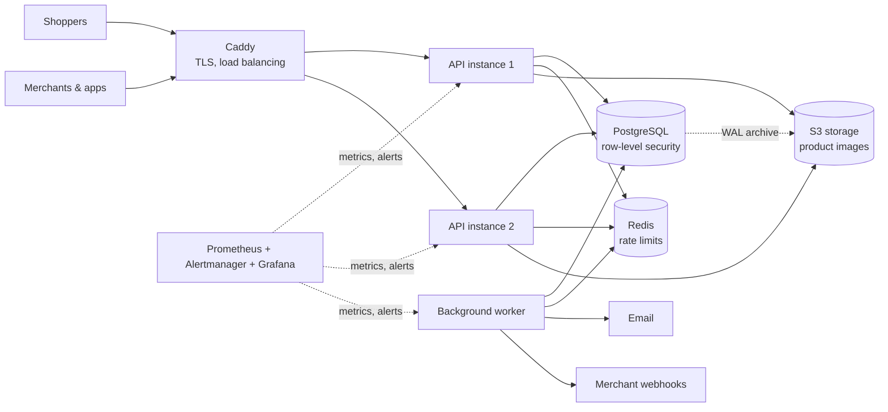

# StoreForge

[](https://github.com/ahmeda335/StoreForge/actions/workflows/ci.yml)


**A multi-tenant e-commerce backend, inspired by Shopify, built to production standards as a learning project.**

Many merchants each run their own online store on one shared platform. Shoppers browse products, check out and pay. Merchants manage products, stock and orders. Developers build apps on a public API. Every store's data is isolated from every other store's, down to the database.

The goal is not another shop. It is to practise the hard parts of backend engineering properly: concurrency, money, security, reliability and operations. Each part is measured, tested and written up with the reasoning behind it.

---

## What it does

| For | Features |
|---|---|
| **Shoppers** | Browse and search a store's catalog, cart, checkout with discount codes, shipping and tax, card payments, order emails |
| **Merchants** | Stores with team members and roles; products with variants and images; inventory with a stock ledger; orders (pay, fulfil, cancel, refund); customers; discounts; shipping rates; an audit log |
| **Developers** | Versioned REST API with API keys and scopes, OAuth apps (authorization code + PKCE), signed outbound webhooks, per-credential rate limits and usage |
| **Platform operators** | Platform admin with two-factor login (TOTP), privacy export and erasure, health, metrics, alerts and runbooks |

## Engineering highlights

Each claim links to the decision, test or experiment behind it.

- **Tenant isolation in the database.** PostgreSQL row-level security means a missing `WHERE store_id = …` can't leak another store's data. The app connects as a role without ownership rights. ([ADR-002](docs/decisions/ADR-002-multi-tenancy-strategy.md), [ADR-009](docs/decisions/ADR-009-tenant-context-and-directory-tables.md))
- **No overselling.** Fifty buyers racing for the last item produce exactly one order. Three approaches were compared under load. ([EXP-004](docs/experiments/EXP-004-oversell-three-ways.md))
- **Safe retries for money.** Checkout completion, payments and refunds are idempotent: a retried request never charges twice. ([ADR-013](docs/decisions/ADR-013-checkout-and-idempotency.md), [ADR-017](docs/decisions/ADR-017-payments.md))
- **Reliable side effects.** Events go through a transactional outbox and a PostgreSQL job queue (`SKIP LOCKED`, leases, retries, dead letters). Emails and webhooks are never lost or sent half-way. ([ADR-016](docs/decisions/ADR-016-async-infrastructure.md))
- **Security reviewed against the OWASP API Top 10**, with a threat model, SSRF-safe webhooks, secret scanning, and image vulnerability scans in CI. ([docs/security](docs/security/README.md))
- **Load-tested.** A seeded dataset of 50 stores and about 400k orders, k6 scenarios, profiling, query fixes with before/after numbers, and SLOs with burn-rate alerts. ([docs/performance](docs/performance/README.md))
- **Production-like delivery.** Separate staging and production stacks, zero-downtime rolling deploys with automatic rollback, continuous backups, and a timed restore drill. ([ADR-031](docs/decisions/ADR-031-single-host-production-and-delivery.md), [EXP-024](docs/experiments/EXP-024-production-like-delivery.md))
- **Failure experiments.** The database, Redis and file storage were killed or slowed under live traffic, and data integrity was checked after each run. Every weakness found was fixed and re-tested. ([EXP-025](docs/experiments/EXP-025-failure-suite-on-staging.md))

## Architecture

A **modular monolith**: one deployable application split into business modules (catalog, inventory, checkout, orders, payments, webhooks, …). The boundaries between modules are verified by tests ([ADR-001](docs/decisions/ADR-001-modular-monolith.md)). One image runs in three roles: API, background worker, and database migrations.



More detail: [architecture overview](docs/architecture/overview.md) · [blueprint](docs/blueprint/README.md).

## Tech stack

| Area | Technology |
|---|---|
| Application | Java 21 (virtual threads), Spring Boot 4, Spring Security, Spring Modulith, Hibernate |
| Data | PostgreSQL 17 (row-level security, full-text search), Flyway migrations, Redis, S3-compatible storage (SeaweedFS) |
| Testing | JUnit 5, Testcontainers (real PostgreSQL), Spring Modulith module checks, k6 load tests, mutation checks |
| Observability | OpenTelemetry, Prometheus, Grafana, Tempo, Loki, structured JSON logs |
| Delivery | Docker, Caddy, GitHub Actions (tests, gitleaks, Trivy, promtool), WAL-G backups |

## Run it locally

You need **Java 21** and **Docker** with Compose v2. Maven comes with the project (`./mvnw`).

```bash
docker compose up -d       # PostgreSQL, Redis, S3 storage, Mailpit (email inbox at http://localhost:8025)
./mvnw spring-boot:run     # API on http://localhost:8080, health and metrics on :8081

curl localhost:8081/actuator/health/readiness
```

Then try the API with the ready-made request files in [`http/`](http/). Open them in IntelliJ or in VS Code with the REST Client extension. Start with `auth.http` (register → verify the email in Mailpit → log in), then `stores.http`, `catalog.http` and `storefront.http` (cart → checkout → payment).

Optional extras:
- **Dashboards and tracing:** `docker compose --profile observability up -d`, run the app with `SPRING_PROFILES_ACTIVE=otel`, and open Grafana at http://localhost:3000.
- **Full production-like stack** (proxy, two API instances, worker, backups, alerting): see [deploy/README.md](deploy/README.md).

## Tests

```bash
./mvnw test      # unit tests and module-boundary checks (no Docker needed)
./mvnw verify    # plus integration tests against real PostgreSQL (needs Docker)
```

About 380 tests: unit, integration, authorization (every endpoint × every role), and concurrency.

## Repository layout

| Path | Contents |
|---|---|
| `src/main/java/dev/storeforge/` | One package per business module (`catalog`, `orders`, `payments`, …) plus `shared` |
| `src/main/resources/db/migration/` | Database schema history (Flyway) |
| `http/` | Example API requests |
| `deploy/` | Staging and production stack, deploy and rollback scripts, backups, failure experiments |
| `load/` | Load-test data seeding and k6 scenarios |
| `infra/` | Local infrastructure config (PostgreSQL roles, Prometheus rules) |
| `docs/` | Everything written down; see below |

## Documentation

Start at [docs/README.md](docs/README.md). The most useful entry points:

- **[Decisions (ADRs)](docs/decisions/README.md):** 32 architecture decisions, each with the options considered and the trade-offs.
- **[Experiments](docs/experiments/README.md):** 25 experiments, each comparing expected and actual behaviour, with the fix.
- **[Learning notes](docs/learning/README.md):** explainers on the patterns used here (outbox, idempotency, row-level security, burn-rate alerting, …).
- **[Runbooks](docs/operations/README.md):** what to do when an alert fires.
- **[API conventions](docs/api/conventions.md):** errors, pagination, concurrency control, rate limits.

## Project status

Built in phases, from foundation to production operations; the current phase is 17 of 18. The phase-by-phase log, with known limitations, is in [docs/PROGRESS.md](docs/PROGRESS.md).
