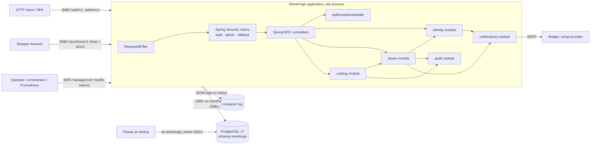
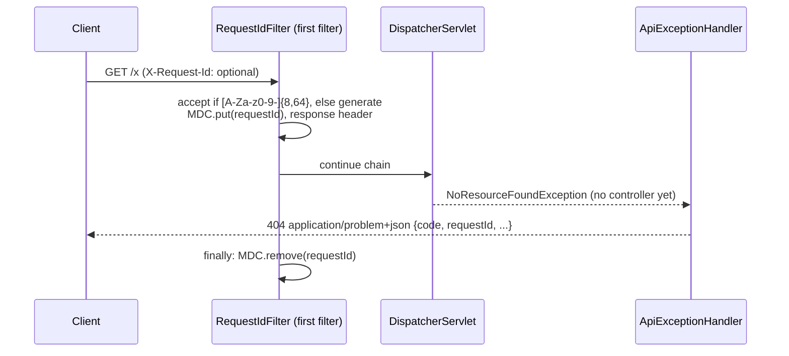
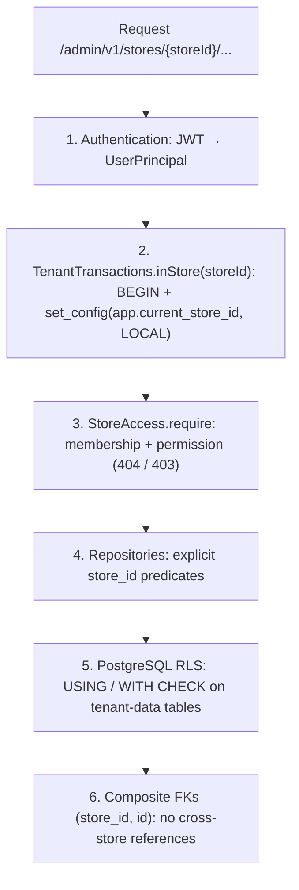
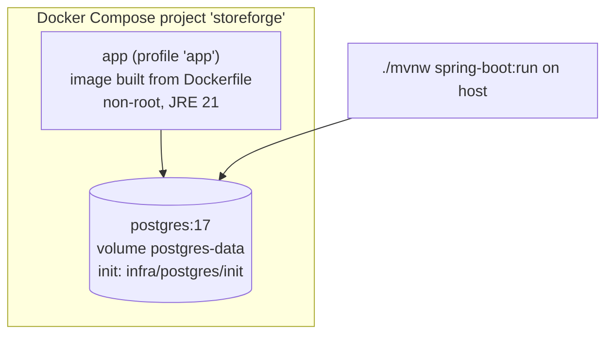

# Architecture Overview (as built)

> This page describes what **exists in code now**. The target architecture is in [blueprint/03-architecture.md](../blueprint/03-architecture.md). Diagrams marked *planned* link to the blueprint and are redrawn here when their phase is implemented.

Current phase: **P4 Catalog** (complete).

## System context (P4)

## Request flow (unauthenticated request, P1)

## Layers inside a module

Defined in [blueprint/03-architecture.md](../blueprint/03-architecture.md#layers-inside-a-module): `web → application → domain ← persistence`, with ports only at external boundaries. Modules so far:

| Module | Type | Contents | Allowed dependents |
|---|---|---|---|
| `shared` | OPEN (all sub-packages usable) | `web` (request IDs, problem details), `error` (`StoreForgeException`, `ConstraintViolations`), `ids` (UUIDv7), `ratelimit`, `time` (`Clock`) | All modules |
| `notifications` | Closed | API: `EmailSender`, `EmailMessage`; internal SMTP adapter | identity (later: outbox jobs) |
| `identity` | Closed | API: `UserPrincipal`, `UserDirectory`; internal web/application/domain/persistence/security | Any module's controllers (via `@AuthenticationPrincipal`); stores |
| `audit` | Closed | API: `AuditLog`, `AuditEntry`; internal JDBC implementation | stores (and every future tenant module) |
| `stores` | Closed | API: `StoreAccess`, `StoreMember`, `Permission`, `StoreDirectory`, `StoreInfo`, `@CurrentStorefront`, exceptions | Every tenant-scoped module |
| `catalog` | Closed | No public API yet; internal domain (Product aggregate), persistence (JPA + SQL read models), admin + storefront controllers | — |

Shared kernel additions in P3: `tenancy` (`StoreId`, `TenantTransactions`), `pagination` (`Cursor`, `Page`), `crypto` (`SecretTokens`), `email` (`EmailAddress`).

### Tenant isolation layers (P3)

See [domains/stores.md](../domains/stores.md#request-flow-tenant-scoped-endpoint) for the full sequence.

### Security filter chains (P2)

| Order | Matcher | Rules |
|---|---|---|
| 1 | `/auth/**` | permitAll; stateless; endpoints protect themselves (rate limits, CSRF checks on cookie endpoints) |
| 2 | `/admin/**` | Bearer JWT required (`NimbusJwtDecoder` ES256 + RFC 9068 validators → `UserTokenConverter`); problem-details 401/403 |
| 3 | `/storefront/**` | Public (anonymous); store resolved from the hostname by `@CurrentStorefront` |
| last | everything else | permitAll (unknown paths → 404; actuator lives on the private management port) |

Authentication and authorization flows: see [domains/identity.md](../domains/identity.md#flows).

Boundaries are verified by `ModularityTest` (Spring Modulith). See [ADR-001](../decisions/ADR-001-modular-monolith.md).

## Deployment view (P1)

## Planned flows (diagrams in the blueprint until implemented)

| Flow | Phase | Blueprint diagram |
|---|---|---|
| Authentication / token refresh | P2 ✅ | [domains/identity.md](../domains/identity.md#flows) |
| Tenant context and RLS | P3 ✅ | [domains/stores.md](../domains/stores.md#request-flow-tenant-scoped-endpoint) |
| Storefront host → store resolution | P4 ✅ | [domains/catalog.md](../domains/catalog.md#flows) |
| Product edit with optimistic concurrency | P4 ✅ | [domains/catalog.md](../domains/catalog.md#flows) |
| Inventory reservation | P5 | [06](../blueprint/06-database.md#inventory-preventing-oversell) |
| Checkout → order | P7–P8 | [06](../blueprint/06-database.md#transactions-and-isolation) |
| Outbox → jobs → handlers | P9 | [09](../blueprint/09-events-async.md#transactional-outbox) |
| Payment | P10 | [10](../blueprint/10-payments.md#lifecycle-and-state-machine) |
| Webhook delivery | P11 | [11](../blueprint/11-webhooks.md) |
| OAuth app installation | P12 | [12](../blueprint/12-developer-platform.md#installation-flow-oauth-20-authorization-code--pkce) |
