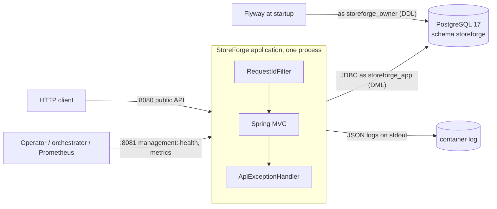
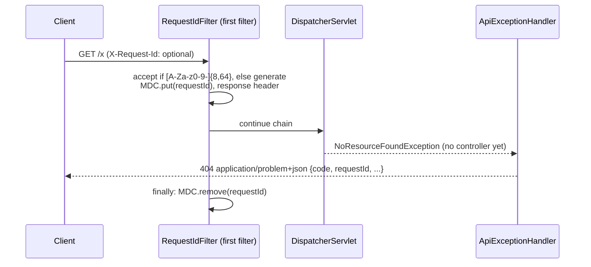
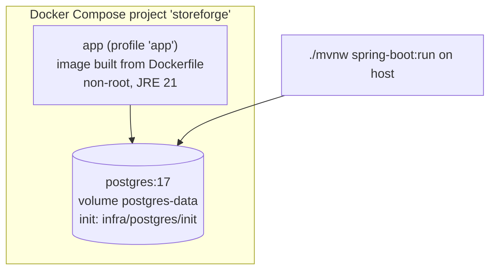

# Architecture Overview (as built)

> This page describes what **exists in code now**. The target architecture is in [blueprint/03-architecture.md](../blueprint/03-architecture.md). Diagrams marked *planned* link to the blueprint and are redrawn here when their phase is implemented.

Current phase: **P1 Foundation**.

## System context (P1)

## Request flow (P1)

## Layers inside a module

Defined in [blueprint/03-architecture.md](../blueprint/03-architecture.md#layers-inside-a-module): `web → application → domain ← persistence`, with ports only at external boundaries. In P1 only the `shared` module exists:

| Module | Type | Contents | Allowed dependents |
|---|---|---|---|
| `shared` | OPEN (all sub-packages usable) | `shared.web`: `RequestIds`, `RequestIdFilter`, `ApiExceptionHandler` | All modules |

Boundaries are verified by `ModularityTest` (Spring Modulith). See [ADR-001](../decisions/ADR-001-modular-monolith.md).

## Deployment view (P1)

## Planned flows (diagrams in the blueprint until implemented)

| Flow | Phase | Blueprint diagram |
|---|---|---|
| Authentication / token refresh | P2 | [07](../blueprint/07-authentication-authorization.md) |
| Tenant resolution and RLS | P3 | [04](../blueprint/04-multi-tenancy.md#request-context) |
| Inventory reservation | P5 | [06](../blueprint/06-database.md#inventory-preventing-oversell) |
| Checkout → order | P7–P8 | [06](../blueprint/06-database.md#transactions-and-isolation) |
| Outbox → jobs → handlers | P9 | [09](../blueprint/09-events-async.md#transactional-outbox) |
| Payment | P10 | [10](../blueprint/10-payments.md#lifecycle-and-state-machine) |
| Webhook delivery | P11 | [11](../blueprint/11-webhooks.md) |
| OAuth app installation | P12 | [12](../blueprint/12-developer-platform.md#installation-flow-oauth-20-authorization-code--pkce) |
