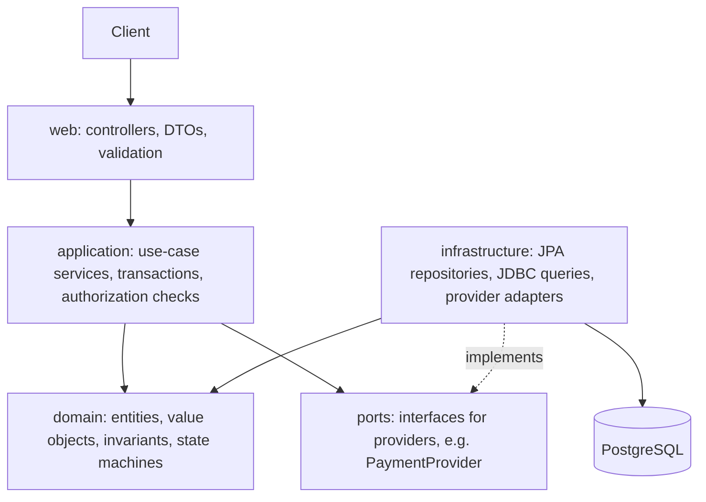
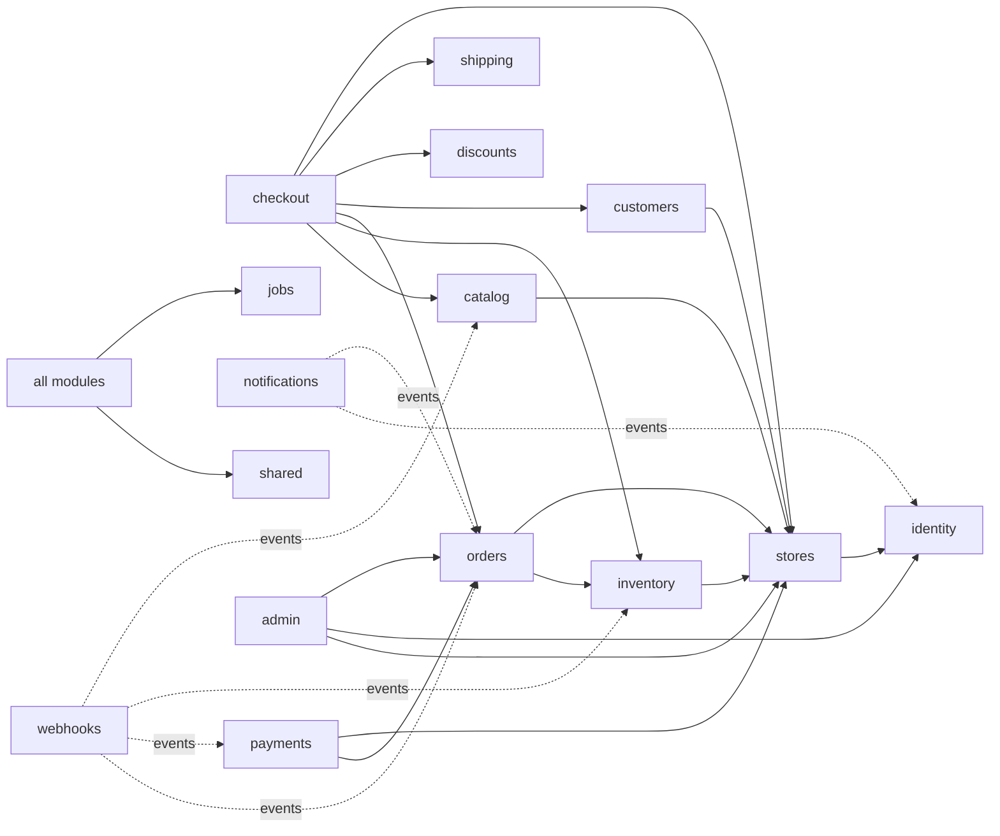

# 03 — Architecture

## Style: modular monolith

**Problem that microservices solve:** independent deployment and scaling for *many teams*, and fault isolation between parts with different load profiles.
**Problems they create:** network failures between every call, distributed transactions, eventual consistency everywhere, versioned contracts, N deployments, N pipelines, and distributed debugging.

StoreForge has one developer, one domain in flux, and no measured scaling bottleneck. A **modular monolith** gives:

- One deployable and one database: ACID transactions across checkout → inventory → order, which matter enormously here.
- Module boundaries enforced by tooling (Spring Modulith verification test), so the system *could* be split later.
- In-process calls that are fast and cannot partially fail.

We still practice distributed-system concepts honestly: the payment provider, email provider, webhook receivers and workers are real asynchronous and unreliable boundaries. See [ADR-001](../decisions/ADR-001-modular-monolith.md).

## Layers inside a module

Pragmatic rule: domain classes may be JPA entities (annotations allowed). We do **not** keep separate "persistence models" mapped to "domain models" unless a module has a concrete reason, because that duplication is the most common overengineering in Java "clean architecture" projects. Hexagonal **ports** exist only at real external boundaries: payment provider, email, object storage, clock.

## Modules (adjusted from the prompt's list)

Changes from the prompt's suggestion, with reasons:
- **Tenants + Stores + Merchant Management → `stores`.** The store *is* the tenant (ADR-002). Staff membership and roles live here because they are store-scoped.
- **Catalog + Products + Product Variants → `catalog`.** Variants cannot exist without their product. They form one aggregate, so one module.
- **Cart + Checkout → `checkout`.** A cart is the working state of a checkout. Splitting them creates chatty coupling.
- **Developer/API Platform → `apps`** (API keys, OAuth apps, installations, scopes). **Webhooks** stay separate because they serve merchants directly too.
- **Billing** (platform subscriptions) and **Analytics** are optional and come late.
- Added **`shared`** (kernel: Money, IDs, error model, tenant context, request IDs) and **`jobs`** (outbox and DB job queue infrastructure).

| Module | Responsibility | Owned data | Public API (to other modules) | Publishes | Consumes | Key invariants | Security |
|---|---|---|---|---|---|---|---|
| `shared` | Kernel types and cross-cutting web/observability plumbing | — | `Money`, `StoreId`, `ApiError`, `TenantContext`, `RequestId` | — | — | Money never uses floating point | No business logic allowed here (keep it small) |
| `identity` | Users, credentials, sessions, refresh tokens, verification/reset tokens | `users`, `refresh_tokens`, `email_tokens` | `CurrentUser`, `UserLookup` | `UserRegistered`, `PasswordResetRequested` | — | Email unique case-insensitively; refresh token single use | Password hashing, enumeration resistance, lockout |
| `stores` | Stores (tenants), domains, staff memberships, roles, permissions, invitations | `stores`, `store_domains`, `store_members`, `roles`, `role_permissions`, `invitations` | `StoreResolver` (host → store), `StoreAccess.check(user, store, permission)` | `StoreCreated`, `StoreSuspended`, `MemberInvited` | `UserRegistered` (pending invitations) | ≥1 owner per store; handle unique; no self-escalation | Central authorization decision point |
| `catalog` | Products, options, variants, collections, images metadata | `products`, `product_variants`, `product_options`, `collections` | `VariantLookup` (price, title, status for checkout) | `ProductCreated/Updated/Deleted`, `VariantPriceChanged` | — | SKU unique per store; ≥1 variant per product; price ≥ 0 | Draft products hidden from storefront |
| `inventory` | Stock levels, reservations, ledger | `inventory_items`, `inventory_reservations`, `inventory_transactions` | `reserve(...)`, `commit(...)`, `release(...)`, `adjust(...)` | `InventoryReserved`, `InventoryReleased`, `InventoryLevelChanged` | `ProductCreated` (create item), `OrderCancelled`, `CheckoutExpired` | `available ≥ 0` (DB CHECK); ledger sums equal levels | Only staff with `inventory:write` adjust |
| `customers` | Store-scoped customer accounts and addresses | `customers`, `customer_addresses` | `CustomerLookup` | `CustomerCreated` | `OrderPlaced` (stats) | Email unique per store | Customer can only read self |
| `checkout` | Carts, checkout sessions, price calculation, order placement orchestration | `carts`, `cart_items`, `checkouts` | — (entry point only) | `CheckoutCompleted`, `CheckoutExpired` | — | Totals recomputed server-side; one order per checkout | Never trust client prices; cart token is a bearer secret |
| `orders` | Orders, line items (snapshots), fulfilment state, cancellations | `orders`, `order_items`, `order_events` | `OrderLookup`, `placeOrder(...)` (called by checkout) | `OrderPlaced`, `OrderPaid`, `OrderCancelled`, `OrderFulfilled` | `PaymentCaptured`, `PaymentFailed` | Line items immutable after placement; state machine | IDOR: order ids never sufficient alone |
| `payments` | Payment intents, transactions, refunds, provider adapters, provider webhooks | `payments`, `payment_transactions`, `refunds`, `provider_events` (inbox) | `PaymentService.start(order)`, `refund(...)` | `PaymentAuthorized`, `PaymentCaptured`, `PaymentFailed`, `RefundSucceeded` | `OrderPlaced`, `OrderCancelled` | Captured ≤ authorized; refunded ≤ captured; provider event processed once | Webhook signature; no PAN storage |
| `discounts` *(Ph2)* | Discount rules, coupon codes, usage | `discounts`, `coupon_codes`, `discount_redemptions` | `evaluate(cart)`, `redeem(...)` | `DiscountRedeemed` | `OrderCancelled` (restore usage) | Usage limit never exceeded | Code enumeration rate-limited |
| `shipping` *(Ph2)* | Shipping zones/rates, shipments | `shipping_rates`, `shipments` | `quote(cart, address)` | `ShipmentCreated` | — | Shipment qty ≤ ordered qty | — |
| `notifications` | Email rendering and sending via jobs | `email_messages` | — | — | `UserRegistered`, `OrderPlaced`, ... | Each message sent at most once *per idempotency key* (best effort) | No secrets in email bodies beyond single-use links |
| `webhooks` *(Ph2)* | Subscriptions, deliveries, signing, retries | `webhook_subscriptions`, `webhook_deliveries` | — | — | Domain events mapped to topics | Delivery per (event, subscription) unique | SSRF filter, HMAC, secret encryption |
| `apps` *(Ph2)* | API keys, OAuth clients, installations, scopes, usage | `api_keys`, `oauth_apps`, `app_installations` | `Credentials.authenticate(token)` | `AppInstalled`, `AppUninstalled` | — | Scopes ⊆ installation grant | Hashed secrets, revocation |
| `audit` | Append-only audit trail | `audit_log` | `AuditLog.record(...)` | — | Many | Append-only (no UPDATE/DELETE grant) | Redaction of sensitive fields |
| `jobs` | Outbox relay, job queue, scheduler | `outbox_events`, `jobs` | `Outbox.append(event)`, `Jobs.enqueue(...)` | — | — | Event appended in same TX as state change | Jobs carry explicit `store_id` |
| `admin` | Platform administration endpoints | — (uses other modules' APIs) | — | `StoreSuspended` (via stores) | — | Every action audited | Separate audience/role, MFA later |
| `analytics` *(opt)* | Read models / rollups | `daily_sales` | — | — | `OrderPlaced`, `RefundSucceeded` | Rebuildable from source | Tenant filter |
| `billing` *(opt)* | Platform plans and entitlements | `subscriptions` | `Entitlements` | — | — | — | — |

## Dependency direction

Rules:
1. **No cycles.** `orders` must not call `payments` synchronously. Payments react to `OrderPlaced`, and orders react to `PaymentCaptured`.
2. Only a module's **top-level package** (its API) may be referenced. Internals (`..internal..`) are private. Spring Modulith's `ApplicationModules.verify()` enforces this in a test.
3. No module reads another module's tables. Cross-module reads go through the owning module's API. Foreign keys *across* modules are allowed (one database) but treated as a coupling we accept knowingly. They would be the first thing to drop when extracting a service.

## Internal communication

- **Synchronous in-process call** when the caller needs an answer *in the same transaction* (checkout → inventory.reserve).
- **Domain event via outbox** when the reaction may happen later or may fail independently (order placed → send email, deliver webhooks, start payment).
- We do not use plain in-memory `ApplicationEventPublisher` for anything that must not be lost. In-memory events vanish on a crash between commit and handling.

## Evolution toward distributed services

1. Modules with no synchronous inbound calls and their own load profile are the first candidates: **webhooks dispatcher**, **notifications**. Both already communicate only through the outbox.
2. Replace the DB queue between them with a broker (RabbitMQ) once the DB queue is measured as a bottleneck or the consumer moves out of process.
3. Remove cross-module foreign keys for the extracted module; replace them with IDs plus events.
4. Extract the process: same code, own deployment, own schema/DB.
5. Only then consider `catalog`/storefront reads as a separately scaled read service (with a read replica or search index).

Triggers are listed in [31-final-deliverables.md](31-final-deliverables.md#e-architecture-evolution).
