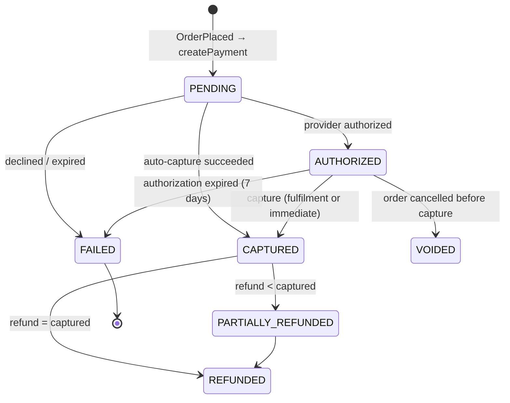

# 10 — Payments

## Abstraction

```text
PaymentProvider (port, in payments module)
    createPayment(PaymentRequest, idempotencyKey) -> ProviderPayment (id, status, clientSecret?)
    capture(providerPaymentId, amount, idempotencyKey)
    voidPayment(providerPaymentId, idempotencyKey)
    refund(providerPaymentId, amount, idempotencyKey)
    parseWebhook(rawBody, headers) -> ProviderEvent        (verifies signature)
    |
    +-- FakePaymentProvider   (in-process, deterministic; failure injection: decline cards, timeouts, delayed/duplicated webhooks)
    +-- StripePaymentProvider (Stripe test mode; PaymentIntents API)
```

The port speaks **our** vocabulary (authorize, capture, refund). Stripe-specific concepts stay in the adapter. The fake provider is not just for tests: it is how failure experiments are run without a network.

## Never store sensitive payment data

The browser sends card details **directly** to the provider (Stripe Elements / Payment Element) using a `client_secret`. StoreForge never sees the card number (PAN) or CVC, which keeps us out of most PCI DSS scope (SAQ-A). We store only: provider payment id, status, amount, card brand and last4 (if the provider returns it), and error codes.

## Lifecycle and state machine



Transitions are implemented as methods on `Payment` that throw on invalid transitions, plus `version` optimistic locking and DB CHECKs (`refunded ≤ captured ≤ amount`).

## Flow

1. Checkout completion (one DB transaction): order `PENDING_PAYMENT`, reservation committed with expiry, outbox `OrderPlaced`.
2. Synchronous part (needed so the browser can show the card form): after the commit, `payments.start(order)` calls the provider `createPayment` with `Idempotency-Key = "payment:" + orderId`, and stores the `Payment(PENDING)` + `clientSecret`. **The provider call is never inside the DB transaction:** holding a transaction (and row locks and a pooled connection) open during a 2–30s network call is how pools get exhausted.
3. The browser confirms the payment with the provider.
4. The provider sends a webhook `payment_intent.succeeded` → signature verified → inbox dedup → payment `CAPTURED` → outbox `PaymentCaptured` → order `PAID`, reservation `SOLD`, emails, merchant webhooks.
5. Safety net: a **reconciliation job** polls the provider for payments stuck `PENDING` > 15 min (webhooks can be lost), and the checkout expiry job releases stock for orders never paid.

## Timeouts: the "unknown outcome" problem

If `createPayment`/`capture` times out, **we do not know** whether the provider performed it. Retrying without an idempotency key may charge twice; giving up may lose a real payment. Rules:
- Every provider call carries an idempotency key derived from *our* stable IDs, so retries are safe.
- On timeout, mark the operation `UNKNOWN` and let a job retry with the same key or query the provider (reconciliation).
- Never tell the customer "failed" on a timeout. Say "processing" and confirm via webhook or polling.

## Provider webhooks (inbound)

- Verify the signature over the **raw body** (before JSON parsing) using the endpoint secret, with timestamp tolerance (5 min) against replay.
- Insert `provider_events(provider, event_id) PRIMARY KEY` **in the same transaction** as the state change. Duplicates (providers retry, sometimes concurrently) become no-ops.
- Out-of-order events: apply only transitions valid from the current state; ignore stale ones (e.g. `processing` after `succeeded`).
- Respond 2xx quickly. Heavy follow-ups go through the outbox.
- Unknown `payment_id` (e.g. created from another environment): log at WARN, return 2xx (otherwise the provider retries forever), and count it in a metric.

## Refunds

`POST .../orders/{id}/refunds` with `Idempotency-Key` → lock the payment row → check `amount ≤ captured - refunded - pending_refunds` → create `Refund(PENDING)` → commit → provider `refund(..., key = refundId)` → webhook/response → `SUCCEEDED` → update `refunded_minor`.

## Security

- Provider secret keys live in the secret store / env. They are never logged, and the key in use is restricted (Stripe restricted keys).
- Webhook endpoint secret per environment.
- Amounts are **always computed server-side** from the order. The client never sends an amount to pay.
- Card-testing defense: rate limit checkout completion per IP/store/cart, plus provider-side Radar.
