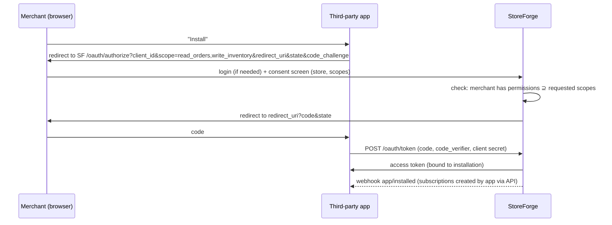

# 12 — Developer Platform

A platform becomes extensible when **outsiders can safely act on a merchant's behalf**. Safety means: least privilege (scopes), revocability, isolation (one store per grant), observability (usage), and stability (versioning).

## Credentials

| Credential | For | Lifetime | Storage | Bound to |
|---|---|---|---|---|
| **API key** (private app) | Merchant's own scripts/integrations | Until revoked | `prefix` + Argon2/SHA-256 hash; shown once | Store + scopes |
| **OAuth app** (client_id/secret) | Third-party developers | Until rotated | Secret hashed | Developer account |
| **Access token** (OAuth) | App acting on a store | Short (1h) + refresh, *or* offline long-lived per installation (simpler, like Shopify's offline tokens). Start with offline tokens, add expiring tokens as a learning step | Hashed (opaque) | Installation (store + app + scopes) |

Why opaque tokens (not JWT) for apps? Revocation on uninstall must be **immediate**. An opaque token is checked in the DB/cache on every call, which makes immediate revocation trivial.

## Scopes

`read_products`, `write_products`, `read_orders`, `write_orders`, `read_inventory`, `write_inventory`, `read_customers` (sensitive: PII). Scopes map to internal permissions. Each developer API endpoint declares its required scope (`@RequiresScope("read_orders")`), verified by an architecture test so that no endpoint is left without a declaration.

## Installation flow (OAuth 2.0 authorization code + PKCE)

- `redirect_uri` exact match against the registered list (open-redirect/code-theft defense). `state` guards CSRF.
- Reinstall with more scopes → new consent. Uninstall → revoke tokens, delete the app's webhook subscriptions, and send the `app/uninstalled` webhook.

Implementation: **Spring Authorization Server** (don't hand-roll OAuth endpoints), customized for installation-bound tokens. Study OAuth 2.0 (RFC 6749), PKCE (RFC 7636) and OAuth 2.0 Security BCP (RFC 9700) first.

## Versioning, rate limiting, usage metrics

- Date-based API versions (see 08). The `X-StoreForge-Api-Version` response header echoes the version in use, and deprecated versions add a `Deprecation` header.
- Rate limit per installation: token bucket (e.g. 40 requests burst, 2/s refill), plus a per-store global cap. Response headers expose the remaining budget.
- Usage metrics: per-installation counters in Redis (requests, 4xx, 5xx, rate-limited) rolled up hourly to `app_usage_hourly` for the merchant's "Apps" page. Not a Prometheus label (cardinality).

## Developer documentation

OpenAPI generated from code (springdoc), published per version; a webhook topic catalog with JSON Schemas; a receiver verification guide (see 11); a sandbox ("development store") flag on stores.

## Example third-party app: **StockSync**

A small separate project (Spring Boot or Node) that keeps an external warehouse spreadsheet/DB in sync:
1. Installs with `read_products, read_inventory, write_inventory, read_orders`.
2. Subscribes to `orders/paid` and `inventory_levels/update`.
3. On `orders/paid` → records the shipment in "warehouse". On warehouse restock (simulated by a CLI) → `POST /api/2026-10/stores/{id}/inventory-items/{itemId}/adjustments` with an `Idempotency-Key`.
4. Verifies webhook signatures, dedups event ids, reconciles nightly via `GET /inventory-items?updatedAfter=`.
5. It exercises everything from the *other side*: scopes, rate limits (it must back off on 429), versioning, replay, secret rotation.
