# 19 — Infrastructure and 20 — CI/CD

## Local (now)

```text
docker compose up -d                 → PostgreSQL 17 (+ later: Mailpit, otel-lgtm, Redis, MinIO)
./mvnw spring-boot:run               → app on :8080, management on :8081
docker compose --profile app up      → app in a container too (production-like)
```
Compose profiles keep optional services (observability, Redis) opt-in until their phase. See [`docs/infrastructure/local-development.md`](../infrastructure/local-development.md).

## Production evolution

| Stage | Topology | What it teaches |
|---|---|---|
| P1: single VM | Caddy/Traefik (TLS via Let's Encrypt) → 2 app containers → managed PostgreSQL (or PG container with backups) on one VM via Compose | DNS, TLS, reverse proxy, health checks, zero-downtime by rolling 2 containers, backups/restore drills |
| P2: managed containers | Cloud load balancer → container service (ECS/Fargate, Cloud Run, Fly.io) with N instances; managed PG + Redis; S3-compatible storage; OTel collector as a sidecar/service | Stateless instances, autoscaling on CPU/latency, managed services' failure modes, IAM |
| P3: Kubernetes (optional) | Ingress → Deployments (api, worker) → HPA; PG stays managed | Declarative ops, probes, rolling updates, resource requests/limits, PodDisruptionBudgets |

**api and worker roles:** the same image runs as `api` (serves HTTP) or `worker` (runs outbox relay and jobs), selected by Spring profile/config. Separating them in production means a flood of webhook jobs cannot starve HTTP threads or the connection pool (a bulkhead), and they scale independently. In Phase 1 both run in one process.

## Operational concerns

| Concern | Design |
|---|---|
| Reverse proxy | TLS termination, HTTP/2, request size limits, `X-Forwarded-*` (Spring `server.forward-headers-strategy=framework`), wildcard cert for `*.storeforge.app`, on-demand TLS for verified custom domains (Caddy) |
| DNS | `storeforge.app` (platform), `*.storeforge.app` (stores), merchant CNAME → `shops.storeforge.app` + TXT verification |
| Configuration | Twelve-factor: env vars override `application.yml`; one image for all environments; profiles only for genuinely different behaviour (`local`, `test`, `prod`) |
| Secrets | Env vars injected from a secret store; never baked into images; rotated (DB passwords, JWT keys with `kid`, provider keys) |
| Health checks | Liveness = "process is not deadlocked" (does **not** check the DB: a DB outage must not restart every instance). Readiness = "can serve traffic" (DB reachable, migrations done, not shutting down). Exposed on the management port `/actuator/health/liveness` & `/readiness` |
| Graceful shutdown | `server.shutdown=graceful`, `spring.lifecycle.timeout-per-shutdown-phase=30s`; on SIGTERM: readiness → OUT_OF_SERVICE, LB drains, in-flight requests finish, workers stop claiming jobs and finish/abandon (lease expires) current ones |
| Connection pools | Hikari `maximumPoolSize` ≈ small (10 per instance); total across instances < PG `max_connections` − admin reserve. More instances → PgBouncer (transaction pooling; note `SET LOCAL` works, session `SET` doesn't, which is another reason for `SET LOCAL`) |
| Resource limits | Container memory limit + JVM `-XX:MaxRAMPercentage=75`; CPU limits sized via load tests |
| Backups | PITR on managed PG; monthly restore drill documented in operations |

## When Kubernetes is worth it here

Learn it **after** P2, when you can articulate what you'd gain: declarative rollout/rollback, self-healing, HPA, a standard platform for many services. For one API + one worker on a managed DB, K8s mostly adds YAML and cluster operations. The trigger is wanting to study orchestration itself, or extracting ≥2 services.

## CI/CD pipeline (GitHub Actions)

```mermaid
flowchart LR
    A[push / PR] --> B[build + unit tests]
    B --> C[static analysis: compiler -Werror, Checkstyle/Spotless, ArchUnit+Modulith verify, Error Prone later]
    C --> D[security: Gitleaks, dependency scan OWASP DC/Trivy fs]
    D --> E[integration + API tests: Testcontainers PG]
    E --> F[build image, Trivy image scan]
    F --> G[push ghcr.io/…:sha]
    G --> H[deploy staging: migrate job → rolling update]
    H --> I[smoke tests + short k6]
    I --> J{manual approval}
    J --> K[deploy prod same image digest]
    K --> L[smoke tests; auto-rollback on failure]
```


Phase 1 implements B–E (single `verify` job). Image build/push/deploy come with production infrastructure.

- **Image versioning:** tag = git SHA (immutable) + semver release tags; deploy by **digest**. Never deploy `latest`.
- **Migrations in CD:** a separate `migrate` step/job (Flyway CLI or the app in `migrate` mode) runs before rollout. Migrations must be **backward compatible with the previous app version** (expand/contract), because during a rolling deploy old and new instances run together, and a rollback runs the old code against the new schema.
- **Rollbacks:** redeploy the previous image digest. Never "down-migrate" automatically. Fix forward for schema.
- **Environment separation:** `local`, `ci`, `staging`, `prod` with separate databases, provider test/live keys, and secrets. GitHub Environments with protection rules for prod.
- **Secrets:** GitHub Actions secrets/OIDC to the cloud (no long-lived cloud keys in CI).
- **Deployment strategies:** rolling (default), blue/green (instant rollback, double capacity), canary (percentage traffic + SLO comparison; needs good metrics). Learn rolling → blue/green → canary in that order.
