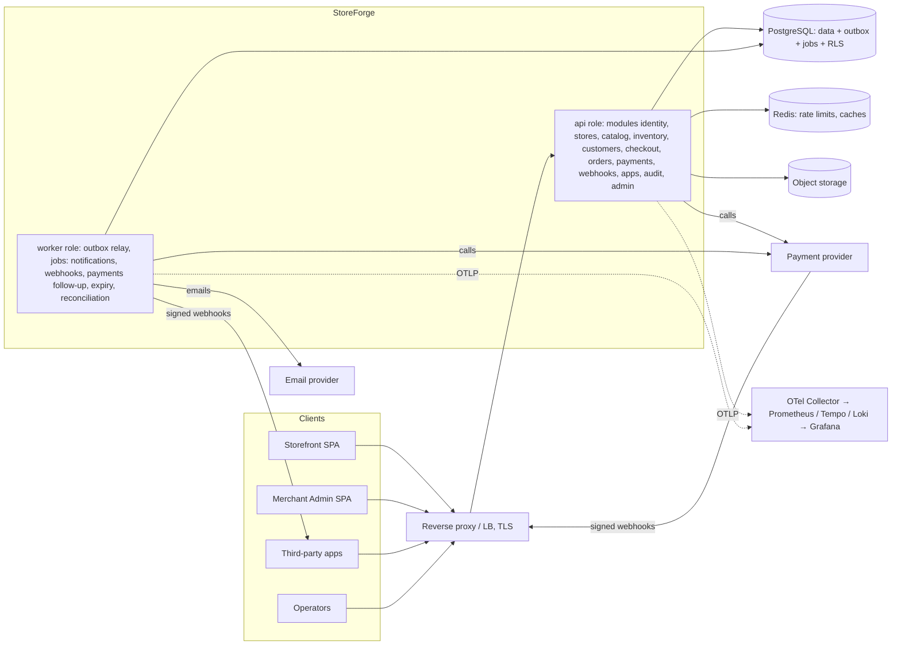

# 31 — Final Deliverables Summary

## A. Complete architecture overview

StoreForge is a **modular monolith** written in Java 21 / Spring Boot 4, deployed as one image that runs in two roles: **api** (HTTP) and **worker** (outbox relay and job processing). It serves four APIs with distinct security models (storefront, merchant admin, developer, platform admin) plus provider callback endpoints.

All state lives in **PostgreSQL**: a shared schema where every tenant row carries `store_id`, protected by explicit tenant-scoped repositories, composite foreign keys and **row-level security** with a transaction-scoped tenant setting. Business operations that must be atomic (checkout → order → stock reservation → event) run in one database transaction. Side effects (payments follow-up, emails, outbound webhooks, search/cache updates) leave through a **transactional outbox** into a **PostgreSQL job queue** with leases, backoff and dead-lettering; all consumers are idempotent. Payments go through a **provider port** (fake + Stripe test mode) whose webhooks are signature-verified and deduplicated via an inbox. Third parties integrate through **API keys / OAuth apps with scopes**, **date-versioned APIs**, and **signed webhooks**.

**Redis** appears when shared state across instances is needed (rate limiting), and caches are added only where measured. Telemetry is emitted via **OpenTelemetry** (traces and metrics over OTLP, JSON logs on stdout) to a Collector → Prometheus/Tempo/Loki → Grafana, with SLO-based alerts. Two Angular apps (merchant admin, storefront) exercise the platform.

## B. Technology stack (with justification)

See [26-technology-selection.md](26-technology-selection.md). Summary: Java 21 + Spring Boot 4 (mature ecosystem), PostgreSQL 17 (transactions, RLS, `SKIP LOCKED`, FTS cover tenancy, queues and search), Flyway (SQL migrations), Spring Modulith (boundary enforcement), Testcontainers (real-DB tests), Docker Compose (reproducible env), GitHub Actions (CI), Spring Security + Authorization Server (auth), OpenTelemetry + Grafana LGTM (observability), Redis + Bucket4j (distributed rate limiting, from P12), Resilience4j (resilience), k6 (load), Caddy (TLS/proxy), MinIO/S3 (images), Angular (frontends). Optional: RabbitMQ, Kafka, OpenSearch, Kubernetes.

## C. Learning roadmap (by prerequisites)

1. HTTP, SQL, transactions/ACID, Spring DI & `@Transactional`, Docker → **P1**
2. Password hashing, JWT, Spring Security, cookies/CSRF/CORS → **P2**
3. Tenancy models, PG roles & RLS, RBAC → **P3**
4. Keyset pagination, optimistic locking, JPA fetching → **P4**
5. MVCC, isolation levels, row locks, deadlocks, `SKIP LOCKED` → **P5**
6. Tracing model, OTel, Prometheus metric types → **P6**
7. Idempotency, money arithmetic → **P7–P8**
8. Dual-write problem, outbox, at-least-once, backoff → **P9**
9. Payment flows, HMAC, unknown outcomes → **P10**
10. SSRF, webhook reliability → **P11**
11. OAuth2 + PKCE, scopes, Redis, distributed rate limiting → **P12**
12. Caching, FTS, object storage → **P13**
13. Threat modeling, MFA → **P14**
14. SLOs, percentiles, load-testing, profiling → **P15**
15. TLS/DNS/proxies, zero-downtime migrations, deployment strategies → **P16**
16. Chaos methodology → **P17**
17. Replication, brokers, Kafka, Kubernetes, sharding → **P18**

## D. Implementation roadmap

See [30-roadmap.md](30-roadmap.md): P0 → P18 plus frontend tracks F1/F2.

## E. Architecture evolution

| Stage | Trigger to move to the next stage |
|---|---|
| **Modular monolith** (P1–P8) | Business flows need side effects that must survive crashes and not slow requests |
| **Async processing** (P9) | Payments, emails and webhooks are reliable and observable via outbox + jobs |
| **External integrations** (P10–P12) | Providers and third parties integrate safely; you need real deployment to learn operations |
| **Production infrastructure** (P15–P16) | Running in prod with SLOs; you need evidence of limits |
| **Scale experiments** (P17–P18) | Load tests show a specific bottleneck: e.g. job throughput (→ broker), storefront reads (→ replica/cache), webhook dispatch competing with API (→ separate worker deployment) |
| **Selective service extraction** | A module has a distinct scaling/failure profile, already communicates only via events, and its boundary has been stable for months. Extract it (webhook dispatcher first) |
| **Sharding / advanced scaling** | One PostgreSQL primary can't handle write volume even after tuning and vertical scaling, or a tenant needs dedicated isolation. Shard by `store_id` |

## F. Study checklist (before each stage)

- [ ] Before P1: Maven lifecycle; Spring Boot auto-config; Docker basics; what Flyway does
- [ ] Before P2: hashing vs. encryption; JWT validation pitfalls; Spring Security filter chain; SameSite cookies
- [ ] Before P3: PG roles & privileges; RLS `USING`/`WITH CHECK`/`FORCE`; `SET LOCAL` vs. `SET`; RBAC
- [ ] Before P4: B-tree composite indexes; keyset pagination; optimistic locking
- [ ] Before P5: MVCC; READ COMMITTED vs. REPEATABLE READ vs. SERIALIZABLE; row locks; deadlocks
- [ ] Before P6: trace/span/context; metric types; cardinality
- [ ] Before P7: idempotency keys; money as minor units
- [ ] Before P9: dual-write problem; outbox; at-least-once; `SKIP LOCKED` queues; backoff+jitter
- [ ] Before P10: authorize vs. capture; idempotency toward providers; HMAC; unknown outcomes
- [ ] Before P11: SSRF; DNS rebinding; signature schemes
- [ ] Before P12: OAuth2 code flow + PKCE; token bucket; Redis atomicity
- [ ] Before P15: percentiles; open vs. closed load models; flame graphs; SLO math
- [ ] Before P16: TLS, DNS, reverse proxies; graceful shutdown; expand/contract migrations
- [ ] Before P18: replication lag; broker semantics; Kafka partitions; K8s primitives

## G. Engineering principles

Correctness lives in the database as much as in code · isolation in depth · idempotency everywhere something can repeat · short transactions, no network inside them · explicit boundaries, one-way dependencies · measure before optimizing · observability and security are part of every feature · prove resilience with experiments · simple until proven insufficient · document decisions when they're made.

## H. Risk register

| Risk | Likelihood | Impact | Mitigation |
|---|---|---|---|
| Cross-tenant data leak | Medium | Critical | 3-layer isolation, RLS meta-test, isolation suite on every endpoint |
| Overselling inventory | Medium | High | Conditional updates + CHECKs + concurrency tests |
| Double charging / lost payment | Medium | Critical | Idempotency keys, inbox, reconciliation job, experiments 3–5 |
| Lost async work (emails/webhooks) | Medium | High | Outbox, leases, DEAD queue + alert |
| Scope creep (building Shopify) | High | High | "Not yet" lists; Phase gates; this scope doc |
| Overengineering / premature tech | High | Medium | ADR required to introduce a technology; "two implementations" rule |
| Module boundary erosion | Medium | Medium | Modulith verify in CI |
| Connection pool exhaustion | Medium | High | No remote calls in TX, pool metrics + alert, timeouts |
| Secrets leaked (Git/logs) | Medium | High | Gitleaks, redaction, log-scan test |
| JWT key compromise | Low | Critical | `kid` rotation, short TTL, `tokens_valid_after` |
| SSRF via webhooks | Medium | High | IP range block at delivery time, no redirects |
| Migration breaks rolling deploy | Medium | High | Expand/contract; migration step separate from rollout |
| Burnout / losing momentum | High | High | Phases end runnable; small commits; celebrate each DoD |
| Learning debt (copying without understanding) | High | High | Learning docs per pattern; "explain it back" check before moving phases |
