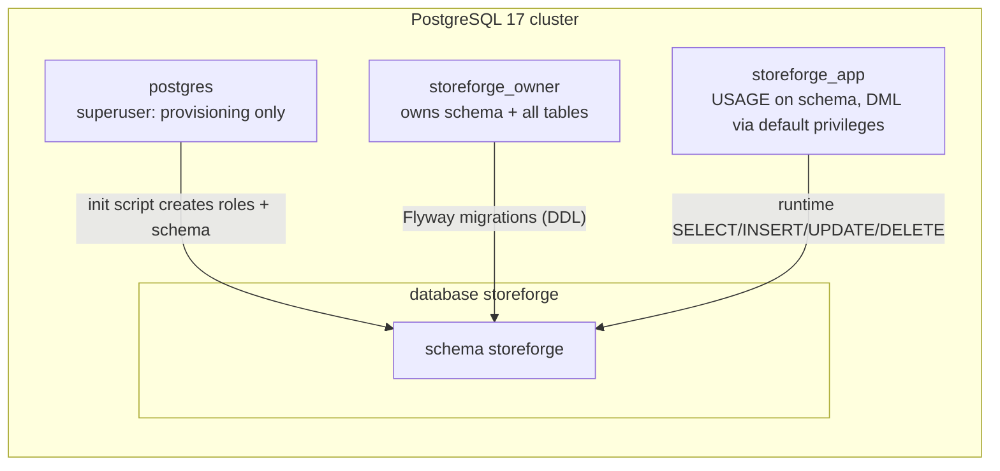

# Database (as built)

Design: [blueprint/06-database.md](../blueprint/06-database.md). Decision: [ADR-006](../decisions/ADR-006-foundation-stack.md).

## Roles and schema

| Role | Used by | Can | Cannot | Settings |
|---|---|---|---|---|
| `postgres` | `infra/postgres/init/01-create-roles.sh` only | Everything | — | Never used by the app |
| `storeforge_owner` | Flyway (`spring.flyway.user`) | DDL in schema `storeforge`; create trusted extensions | — | `search_path=storeforge` |
| `storeforge_app` | Application (`spring.datasource.username`) | DML on tables, use sequences, execute functions | CREATE/ALTER/DROP (SQLSTATE 42501, tested) | `search_path=storeforge`, `statement_timeout=10s`, `idle_in_transaction_session_timeout=30s` |

Why: least privilege, plus RLS in P3 only applies to non-owner roles ([ADR-002](../decisions/ADR-002-multi-tenancy-strategy.md)).

`public` schema: `CREATE`/usage revoked from `PUBLIC`; nothing lives there.

## Migrations

| Version | File | Purpose |
|---|---|---|
| V1 | `V1__baseline_privileges.sql` | Default privileges: every future table/sequence/function created by the owner is usable by the app role |
| V2 | `V2__identity.sql` | `citext` extension; `users`, `refresh_tokens`, `email_tokens` (see [domains/identity.md](../domains/identity.md)) |

## Access patterns: JPA vs. JdbcClient

| Use | Tool | Example |
|---|---|---|
| Load/modify/save an aggregate | Spring Data JPA (`ddl-auto=validate`, `open-in-view=false`, `@Version`, `@DynamicUpdate`) | `User` |
| Statements whose SQL *is* the design (atomic conditional updates, `RETURNING`, counters) | `JdbcClient` with named parameters | `RefreshTokenStore.consume`, `UserLoginCounters.recordFailure` |

## Concurrency patterns in use

| Pattern | Where | Prevents |
|---|---|---|
| Unique constraint as arbiter | `uq_users_email` | Duplicate accounts under concurrent registration (check-then-insert race) |
| Conditional `UPDATE ... WHERE <still valid> RETURNING` | refresh tokens, email tokens | Double use of single-use tokens |
| Atomic increment `x = x + 1` | `failed_login_count` | Lost updates of the lockout counter |
| `@DynamicUpdate` | `User` | A stale entity overwriting columns updated by atomic SQL |

Migration rules (from the blueprint):
- `src/main/resources/db/migration/V{n}__snake_case_description.sql`; never edit an applied migration (checksum).
- Migrations run at startup in dev/test. In production they run as a separate step before rollout (P16).
- Expand → migrate → contract for breaking changes; `CREATE INDEX CONCURRENTLY` for large tables.
- Placeholder `${app_role}` is available (configured via `spring.flyway.placeholders.app_role`).

## Provisioning gotcha

The init script runs **only when the data volume is empty**. After changing it locally: `docker compose down -v && docker compose up -d` (this deletes local data).
