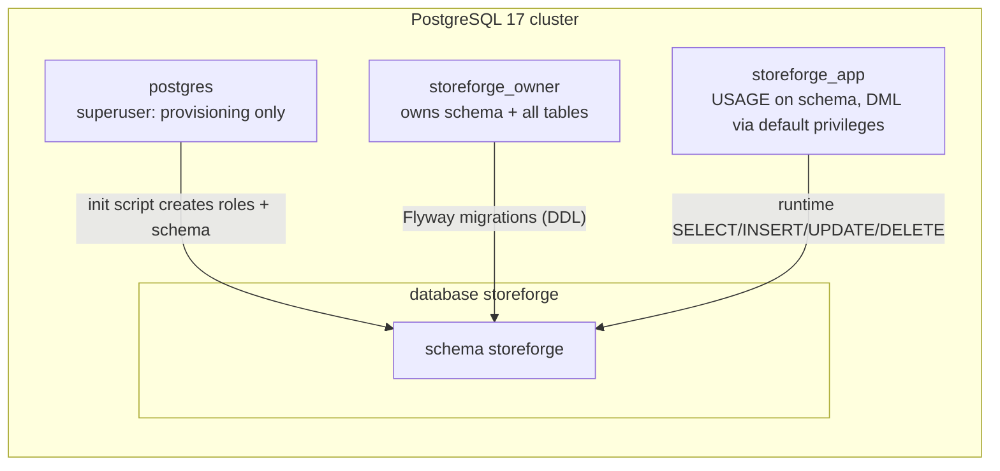

# Database (as built)

Design: [blueprint/06-database.md](../blueprint/06-database.md). Decision: [ADR-006](../decisions/ADR-006-foundation-stack.md).

## Roles and schema

| Role | Used by | Can | Cannot | Settings |
|---|---|---|---|---|
| `postgres` | `infra/postgres/init/01-create-roles.sh` only | Everything | — | Never used by the app |
| `storeforge_owner` | Flyway (`spring.flyway.user`) | DDL in schema `storeforge`; create trusted extensions | — | `search_path=storeforge` |
| `storeforge_tenant_scanner` | Owner of narrow SECURITY DEFINER functions | `BYPASSRLS`, but **NOLOGIN**; nobody can become it except via its functions | Log in; the app role is not a member | — |
| `storeforge_app` | Application (`spring.datasource.username`) | DML on tables, use sequences, execute functions | CREATE/ALTER/DROP (SQLSTATE 42501, tested) | `search_path=storeforge`, `statement_timeout=10s`, `idle_in_transaction_session_timeout=30s` |

Why: least privilege, plus RLS in P3 only applies to non-owner roles ([ADR-002](../decisions/ADR-002-multi-tenancy-strategy.md)).

`public` schema: `CREATE`/usage revoked from `PUBLIC`; nothing lives there.

## Migrations

| Version | File | Purpose |
|---|---|---|
| V1 | `V1__baseline_privileges.sql` | Default privileges: every future table/sequence/function created by the owner is usable by the app role |
| V2 | `V2__identity.sql` | `citext` extension; `users`, `refresh_tokens`, `email_tokens` (see [domains/identity.md](../domains/identity.md)) |
| V19 | `V19__customer_erasure.sql` | `customers.erased_at` (P14 privacy, [ADR-027](../decisions/ADR-027-customer-data-export-and-erasure.md)) |
| V18 | `V18__platform_admins.sql` | `platform_admins` (sealed TOTP secret, last step, recovery code hashes; **app role can't INSERT/DELETE**), `platform_audit_log` (append-only). See [domains/platform.md](../domains/platform.md) |
| V17 | `V17__product_images.sql` | `product_images` (PENDING/READY, CHECKed tenant-prefixed `object_key`, RLS), `stores_with_abandoned_image_uploads()` definer fn. See [domains/storage.md](../domains/storage.md) |
| V16 | `V16__search_under_rls.sql` | `search_product_matches(query)`: SECURITY DEFINER match step scoped by `current_store_id()`, ids and scores only ([ADR-025](../decisions/ADR-025-search-in-postgresql-and-no-cache.md), [EXP-018](../experiments/EXP-018-search-at-scale-under-rls.md)) |
| V15 | `V15__product_search.sql` | `unaccent`, `pg_trgm`, `btree_gin`; `product_search` text search config; `search_normalize()`; generated weighted `products.search_vector`; GIN indexes |
| V14 | `V14__shipping.sql` | `shipping_rates`, `shipments`, `shipment_items` (RLS); `PARTIALLY_FULFILLED`; shipment timeline events; rate on checkouts, name on orders. See [domains/shipping.md](../domains/shipping.md) |
| V13 | `V13__discounts.sql` | `discounts` (citext code, CHECK `usage_count <= usage_limit`), `discount_redemptions` (RLS, partial unique per customer); discount on checkouts and orders; total identity CHECK. See [domains/discounts.md](../domains/discounts.md) |
| V12 | `V12__oauth_apps.sql` | `oauth_apps` (platform), `app_installations` (RLS, one active per store+app), `oauth2_authorization` (Spring Authorization Server, PostgreSQL types; rows deleted at token issuance). See [domains/developer.md](../domains/developer.md#data-v11-v12) |
| V11 | `V11__developer_platform.sql` | `api_credentials` (directory: token hash lookup), `app_usage_hourly` (RLS), `webhook_subscriptions.owner_credential_id`, `(store_id, updated_at, id)` indexes for sync feeds |
| V10 | `V10__webhooks.sql` | `webhook_subscriptions` (topics `text[]`, encrypted secrets, failure counters), `webhook_deliveries` (`UNIQUE (subscription_id, event_id)`, payload as `text`), `webhook_delivery_attempts`; all RLS; `purge_webhook_deliveries()` delete-only definer fn. See [domains/webhooks.md](../domains/webhooks.md#data-v10) |
| V9 | `V9__payments.sql` | `payments`, `payment_operations`, `refunds` (RLS); `provider_events` (infrastructure, webhook dedup PK); orders: refund statuses, `refunded_minor`, cancel-after-refund CHECK; `stores_with_stale_payments()` definer fn. See [domains/payments.md](../domains/payments.md#data-v9) |
| V8 | `V8__outbox_jobs_notifications.sql` | Infrastructure tables `outbox_events`, `jobs`, `email_messages` (no RLS, ADR-016); inbox `processed_messages` (RLS); customer stats columns; `purge_idempotency_keys()` delete-only definer fn. See [domains/jobs.md](../domains/jobs.md) |
| V7 | `V7__orders.sql` | `orders` (state CHECKs, one per checkout), immutable `order_items`/`order_events`, `store_counters`, `checkouts.order_id`, `stores_with_overdue_orders()` definer fn. See [domains/orders.md](../domains/orders.md) |
| V6 | `V6__customers_cart_checkout.sql` | `customers`, `carts` (hashed token), `cart_items`, `checkouts` (one OPEN per cart), `checkout_lines` (frozen snapshot, `line_total = unit × qty` CHECK), `idempotency_keys`. All RLS. See [domains/checkout.md](../domains/checkout.md) |
| V5 | `V5__inventory.sql` | `inventory_items` (CHECK `reserved <= on_hand`), `inventory_reservations`, append-only `inventory_transactions`, RLS; `stores_with_expired_reservations()` SECURITY DEFINER ([ADR-011](../decisions/ADR-011-cross-tenant-background-work.md)) |
| V4 | `V4__catalog.sql` | `products`, `product_variants` (RLS, composite FK, partial unique SKU, `NULLS NOT DISTINCT` option combos). See [domains/catalog.md](../domains/catalog.md) |
| V3 | `V3__stores_tenancy.sql` | `current_store_id()`; directory tables `stores`, `store_domains`, `store_members`; RLS tables `roles`, `invitations`, `audit_log` (append-only for the app). See [domains/stores.md](../domains/stores.md) |

## Row-level security (P3)

| Table kind | Tables | Protection |
|---|---|---|
| Platform | `users`, `refresh_tokens`, `email_tokens` | Not tenant data |
| Tenant directory | `stores`, `store_domains`, `store_members` | Application scoping by the stores module only ([ADR-009](../decisions/ADR-009-tenant-context-and-directory-tables.md)) |
| Platform infrastructure | `outbox_events`, `jobs`, `email_messages` | Owned by jobs/notifications; tenant effects run in tenant transactions ([ADR-016](../decisions/ADR-016-async-infrastructure.md)) |
| Tenant data | `roles`, `invitations`, `audit_log`, `products`, `product_variants`, `inventory_items`, `inventory_reservations`, `inventory_transactions`, `customers`, `carts`, `cart_items`, `checkouts`, `checkout_lines`, `idempotency_keys`, `orders`, `order_items`, `order_events`, `store_counters` (+ every future business table) | `ENABLE` + `FORCE ROW LEVEL SECURITY`, policy `tenant_isolation` `USING`/`WITH CHECK (store_id = current_store_id())` |

Checklist for every new tenant-data table: `store_id uuid NOT NULL` → indexes lead with `store_id` → `UNIQUE (store_id, id)` if children reference it → composite FKs to parents → ENABLE + FORCE RLS + `tenant_isolation` policy **in the same migration**. `RowLevelSecurityIT` fails the build if the RLS part is missing.

## Access patterns: JPA vs. JdbcClient

| Use | Tool | Example |
|---|---|---|
| Load/modify/save an aggregate | Spring Data JPA (`ddl-auto=validate`, `open-in-view=false`, `@Version`, `@DynamicUpdate`, `@EntityGraph`, JDBC batching) | `User`, `Store`, `Role`, `Product` |
| List screens (read models) | `JdbcClient` SQL returning exactly the displayed columns; constant query count | `ProductQueries` |
| Statements whose SQL *is* the design (atomic conditional updates, `RETURNING`, counters) | `JdbcClient` with named parameters | `RefreshTokenStore.consume`, `UserLoginCounters.recordFailure` |

## Concurrency patterns in use

| Pattern | Where | Prevents |
|---|---|---|
| Unique constraint as arbiter | `uq_users_email` | Duplicate accounts under concurrent registration (check-then-insert race) |
| Conditional `UPDATE ... WHERE <still valid> RETURNING` | refresh tokens, email tokens | Double use of single-use tokens |
| Atomic increment `x = x + 1` | `failed_login_count` | Lost updates of the lockout counter |
| `@DynamicUpdate` | `User` | A stale entity overwriting columns updated by atomic SQL |
| Parent-row lock (`SELECT ... FOR UPDATE` on `stores`) | Owner changes | Write skew on "≥ 1 owner" ([EXP-003](../experiments/EXP-003-write-skew-last-owner.md)) |
| Composite FK `(store_id, x_id)` | `store_members`, `invitations` → `roles`; variants, inventory | Cross-tenant references |
| Conditional `UPDATE ... WHERE on_hand - reserved >= q` + CHECK | `inventory_items` | Oversell ([EXP-004](../experiments/EXP-004-oversell-three-ways.md)) |
| Deterministic lock order (sort by id) | Multi-line reservations | Deadlocks (40P01) |
| `FOR UPDATE SKIP LOCKED` batches | Reservation sweeper | Workers blocking each other / double processing |
| `INSERT ... ON CONFLICT DO NOTHING` | Lazy inventory item creation | Duplicate rows on concurrent first use |
| `INSERT ... ON CONFLICT DO UPDATE ... RETURNING` | Customer upsert, cart item increment | Check-then-insert races |
| Uncommitted key row blocks duplicates | `idempotency_keys` | Concurrent retries running the work twice ([EXP-006](../experiments/EXP-006-duplicate-checkout-completion.md)) |
| `FOR UPDATE OF c` on the checkout | Completion | Double completion with different keys |
| Counter row `UPDATE … RETURNING` | `store_counters` | Duplicate/gapped order numbers under concurrency |
| `PESSIMISTIC_WRITE` (`FOR UPDATE`) + `@Version` | Order transitions | Pay vs. cancel both succeeding ([EXP-007](../experiments/EXP-007-pay-vs-cancel-race.md)) |
| CHECKs on state combinations | `orders` | Impossible states from buggy code |
| Claim `UPDATE … WHERE id IN (SELECT … FOR UPDATE SKIP LOCKED)` + leases | `jobs` | Double execution by concurrent workers ([EXP-008](../experiments/EXP-008-async-guarantees-mutations.md)) |
| Inbox row in the same transaction as the effect | `processed_messages` | Double effects on redelivery |
| CHECK `refunded ≤ captured ≤ amount` + payment row lock for refunds | `payments`, `refunds` | Over-refunding under concurrency ([EXP-010](../experiments/EXP-010-payment-mutations.md)) |
| `UNIQUE (store_id, order_id)` + `INSERT … ON CONFLICT DO NOTHING` | `payments` | Two payments for one order when starts race |
| PK `(provider, event_id)` | `provider_events` | Duplicate webhook processing |
| `UNIQUE (subscription_id, event_id)` + `ON CONFLICT DO NOTHING` | `webhook_deliveries` | Duplicate outbound webhooks on event redelivery |
| Transaction advisory lock per store | `webhook_subscriptions` | Quota exceeded by concurrent creations (write skew) |

Migration rules (from the blueprint):
- `src/main/resources/db/migration/V{n}__snake_case_description.sql`; never edit an applied migration (checksum).
- Migrations run at startup in dev/test. In production they run as a separate step before rollout (P16).
- Expand → migrate → contract for breaking changes; `CREATE INDEX CONCURRENTLY` for large tables.
- Placeholder `${app_role}` is available (configured via `spring.flyway.placeholders.app_role`).

## Provisioning gotcha

The init script runs **only when the data volume is empty**. After changing it locally: `docker compose down -v && docker compose up -d` (this deletes local data).
