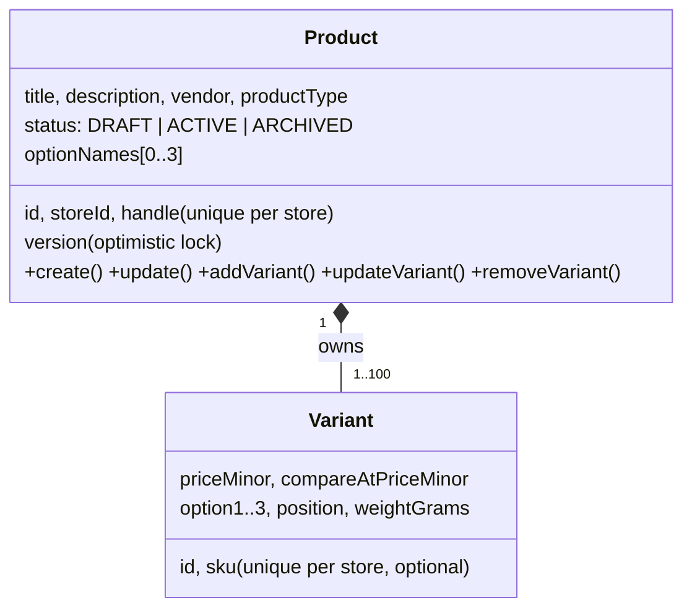
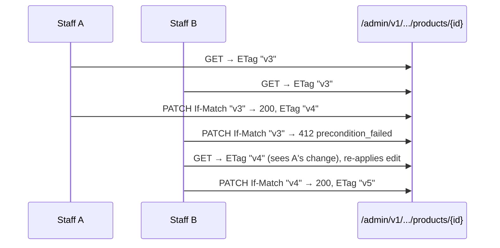

# Module: catalog (P4)

**Responsibility:** products, their options and variants (prices, SKUs, weights). Two faces: the merchant admin API (read/write, permission-checked) and the public storefront API (read-only, ACTIVE products, store from hostname).

**Public API:** none yet (checkout gets a `VariantLookup` in P7). **Depends on:** `shared`, `stores` (`StoreAccess`, `StoreDirectory`, `@CurrentStorefront`), `audit`, `identity` (`UserPrincipal`).

## Aggregate

| Invariant | Where |
|---|---|
| 1–100 variants; last variant can't be removed | `Product` (409 `last_variant`) |
| 0–3 unique option names; each variant has exactly one value per option | `Product` (422 `invalid_product`) |
| Unique option combination per product | `Product` + `uq_product_variants_options` (`NULLS NOT DISTINCT`) → 409 `duplicate_variant` |
| SKU unique per store (when present) | Partial unique index `uq_product_variants_store_sku` → 409 `sku_taken` |
| Handle unique per store | `uq_products_store_handle` (citext) → 409 `handle_taken` |
| price ≥ 0, compare-at > price, at most the currency's decimals | `Money.parse`, `Product`, CHECK constraints |
| Variant belongs to a product of the same store | Composite FK `(store_id, product_id)` |
| Concurrent edits don't silently overwrite | `@Version` + `ETag`/`If-Match` ([ADR-010](../decisions/ADR-010-catalog-persistence-and-concurrency.md)) |

## Data
`products`, `product_variants`: tenant data with RLS (`V4__catalog.sql`). Indexes: `(store_id, created_at DESC, id DESC)`, `(store_id, status, created_at DESC, id DESC)`, `(store_id, product_id, position)`.

## Flows

Edit with optimistic concurrency:

Storefront request: `Host`/`X-Forwarded-Host` → `@CurrentStorefront` (cached `StoreDirectory.resolveHost`, ACTIVE only) → `TenantTransactions.inStore` → `ProductQueries` (2 statements for the list) → public DTO (no SKU, no status).

## Tests
`ProductAdminIT` (creation and money, aggregate rules, If-Match 412, **6 concurrent writers → exactly one 200**, variant lifecycle with version bumps and audit, filters/sort/pagination, `%` literal, invalid sort, read-only role), `StorefrontCatalogIT` (active only, internal fields hidden, handles per store, unknown host, **N+1 detector**), `MoneyTest`, plus the catalog endpoints in `TenantIsolationIT`.

## P13: search and images
- **Search** (`GET /storefront/v1/search`, `ProductSearch`): weighted full text + trigram typos, filters, sorts, disjunctive facets, one statement; the match step runs in the tenant-bound definer function `search_product_matches` ([ADR-025](../decisions/ADR-025-search-in-postgresql-and-no-cache.md), [EXP-018](../experiments/EXP-018-search-at-scale-under-rls.md)). Tests: `ProductSearchIT`.
- **Images** (`ProductImageService`, `ImageUploadSweeper`, `AdminProductImagesController`): see [storage.md](storage.md). Storefront products include `images: [{url, alt}]`.

## Known limitations
- Admin product search is still `ILIKE` on title. No collections.
- Archiving is `PATCH status=ARCHIVED`. There is no hard delete (orders will reference products).
- No inventory or availability on the storefront yet (P5).
- Storefront responses are not HTTP-cacheable yet (P13).
- A storefront list currently costs **9 SQL statements** (transaction setup, tenant `set_config`, page, variants). That baseline gets investigated in P15.
