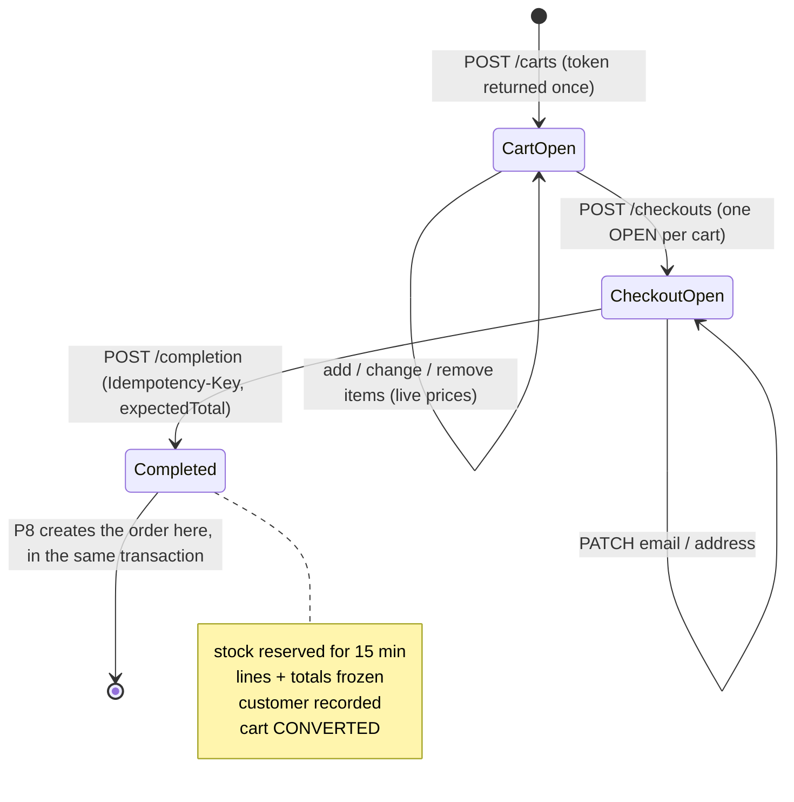

# Modules: checkout and customers (P7)

**checkout** (no public API; storefront entry point) orchestrates **catalog** (`VariantLookup`: current price and sellability), **inventory** (`Inventory.reserve`), **customers** (`Customers.findOrCreate`) and **shared** (`Idempotency`, `TenantTransactions`, `Money`).
**customers** (public API `Customers`) holds store-scoped guest customers; merchants list them with `customers:read`.

## Lifecycle



## Completion transaction

```mermaid
sequenceDiagram
    participant C as Shopper (X-Cart-Token, Idempotency-Key)
    participant API as POST /checkouts/{id}/completion
    participant DB as PostgreSQL (one tenant transaction)
    C->>API: {expectedTotal: "49.00"}
    API->>DB: INSERT idempotency_keys (claim) — duplicates wait here
    alt key already completed
        API-->>C: 200 stored body, Idempotent-Replayed: true
    end
    API->>DB: SELECT checkout ⋈ cart(token_hash) FOR UPDATE; status = OPEN?
    API->>DB: cart items → VariantLookup (catalog prices, ACTIVE only)
    API->>API: total == expectedTotal? (else 409 total_changed)
    API->>DB: Inventory.reserve (conditional UPDATEs, sorted, all-or-nothing)
    API->>DB: customers upsert · checkout_lines insert · checkout COMPLETED · cart CONVERTED
    API->>DB: UPDATE idempotency_keys SET response · COMMIT
    API-->>C: 200 completed checkout, Idempotent-Replayed: false
```

## Invariants

| Invariant | Where |
|---|---|
| Only the cart-token holder can see or change a cart/checkout | Token hash in every lookup; 404 otherwise |
| Prices come from the catalog, never from the client | `Pricing` |
| The customer is never committed to an amount they didn't see | `expectedTotal` check → 409 `total_changed` |
| One OPEN checkout per cart | Partial unique index `uq_checkouts_open_per_cart` |
| A checkout completes at most once | `FOR UPDATE` + `status = 'OPEN'` + idempotency key |
| A completed checkout never changes | Frozen `checkout_lines` and totals (`ck_checkout_lines_amounts`: `line_total = unit × qty`) |
| Stock reserved atomically with completion | `Inventory.reserve` joins the transaction |
| One customer per email per store | `uq_customers_store_email` + upsert |
| Max 50 lines, 1–100 per line | `CartService`, `ck_cart_items_quantity` |

## Tests
`CartIT`, `CheckoutIT`, `CheckoutIdempotencyIT` (see [testing](../testing/README.md)); admin customers endpoints are covered by `TenantIsolationIT`.

## Known limitations
- No orders yet (P8). A completed checkout whose reservation expires simply loses its stock hold. P8 handles expiry.
- No payment (P10), shipping rates or tax (P13): `shipping` and `tax` are 0.
- No storefront customer accounts. Abandoned carts and old idempotency keys are not cleaned up yet (P9 jobs).
- No storefront rate limiting (cart creation abuse, P12).
