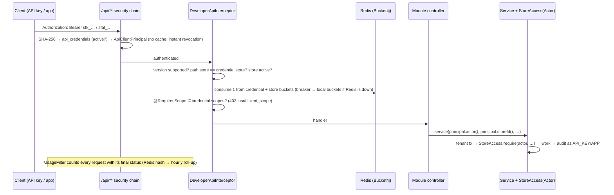

# Module: developer (P12)

**Responsibility:** letting code outside StoreForge act on a store:
- credentials: API keys, app installations;
- scopes;
- the developer API's cross-cutting rules: authentication, store binding, versions, rate limits, usage;
- OpenAPI;
- OAuth apps: registration, the authorization server, installations.

**Public API:** `Scope`, `RequiresScope`, `ApiClientPrincipal`, `DeveloperApi`, `ApiCredentialRevoked`.
**Depends on:** `stores` (`StoreAccess`, `Actor`, `StoreDirectory`), `identity` (`PasswordAuthenticator`, `UserPrincipal`), `audit`, `shared`.
**Used by:** catalog, orders, inventory and webhooks (their developer controllers), and webhooks (revocation listener).
**Decisions:** [ADR-020](../decisions/ADR-020-redis-fail-open.md) (Redis), [ADR-021](../decisions/ADR-021-developer-api-and-credentials.md) (developer API), [ADR-022](../decisions/ADR-022-oauth-apps.md) (OAuth apps).
**API:** [api/developer.md](../api/developer.md). **Sample app:** [samples/stocksync](../../samples/stocksync/README.md).

## A developer API request



## An app installation

```mermaid
sequenceDiagram
    participant M as Merchant browser
    participant App as App (StockSync)
    participant AS as StoreForge authorization server
    M->>App: /install?store=shop.storeforge.localhost
    App->>M: 302 /oauth2/authorize?client_id&redirect_uri&scope&state&code_challenge&store
    M->>AS: authorize → /oauth/login (PasswordAuthenticator: rate limits, lockout) → /oauth/consent
    AS->>AS: consent page: store, app, scopes; Install only if merchant holds apps:manage + scope permissions
    M->>AS: POST approve → 302 redirect_uri?code&state
    App->>AS: POST /oauth2/token (client secret, code, code_verifier)
    AS->>AS: InstallationTokenGenerator: re-check permissions, replace old installation, create sfat_ credential
    AS->>AS: delete pending authorization (no plaintext token stored; code single-use)
    AS-->>App: {access_token: sfat_…, scope, store_id}
    App->>AS: /api/2026-10/stores/{store_id}/webhook-subscriptions …
```

## Data (V11, V12)

| Table | Kind | Notes |
|---|---|---|
| `api_credentials` | Directory (no RLS) | `token_hash` UNIQUE (SHA-256), `token_prefix`, kind `API_KEY`/`APP_INSTALLATION`, scopes, `revoked_at`, `last_used_at` (≤1 write/min) |
| `app_usage_hourly` | Tenant (RLS) | Requests, 4xx, 5xx, rate-limited per credential and hour (from Redis) |
| `webhook_subscriptions.owner_credential_id` | Tenant | App-owned subscriptions; deleted with the credential (event, same transaction) |
| `oauth_apps` | Platform (no store) | Client id, Argon2 secret hash, exact redirect URIs, max scopes; owned by a developer (user) |
| `app_installations` | Tenant (RLS) | Store + app + scopes + credential; one active per (store, app) |
| `oauth2_authorization` | Infrastructure | Spring Authorization Server's pending authorizations (PostgreSQL types); rows deleted at token issuance |
| indexes `orders`/`inventory_items (store_id, updated_at, id)` | | The "changed since" sync feeds |

## Configuration
- **`storeforge.developer.*`:**
  - `per-credential` 40 burst / 2 per s, `per-store` 100 / 5 per s;
  - `max-api-keys-per-store` 25;
  - `usage-retention-in-redis` 3d.
- **`storeforge.redis.*`:** `url` (`REDIS_URL`), `command-timeout` 250ms, `reconnect-backoff` 5s.
- **Health:** status order with `DEGRADED` (HTTP 200).
- **springdoc:** `/developer/openapi`, `/api/**` only.

## Tests

| Test | What it proves |
|---|---|
| `DeveloperApiIT` (8) | Architecture rule (every `/api/**` handler has `@RequiresScope`); key shown once; store binding (404); `insufficient_scope` + `WWW-Authenticate`; unknown version; missing, forged and user-JWT tokens → 401; revocation on the next request; anti-escalation; orders sync feed with cursor; idempotent adjustment audited as `API_KEY`; app-owned subscriptions follow scopes and revocation; OpenAPI covers only `/api/**` |
| `RateLimitIT` (4) | Burst → 429 + `Retry-After`, counted in usage (rejected requests included); **budget shared across instances via Redis**; **store-wide cap**; **frozen Redis**: still serving with local limits, no waiting once the breaker opens, health 200/DEGRADED, recovery |
| `OAuthInstallIT` (8) | Full browser + app flow; reinstall replaces and uninstall revokes + deletes subscriptions; **forged consent** and **scope escalation** refused at issuance; PKCE verifier; code replay; wrong secret; foreign redirect (no redirect at all); missing PKCE; excess scopes; shared login lockout; the OAuth session can't call the APIs; no plaintext tokens stored |

Mutation-checked in [EXP-016](../experiments/EXP-016-developer-platform-mutations.md).

## Known limitations
- The OAuth browser session is in memory (sticky sessions or Spring Session Redis for multiple instances).
- No `app/uninstalled` webhook; no app review or marketplace; offline tokens without expiry.
- Credential lookup isn't cached (a deliberate trade-off for instant revocation).
- No per-endpoint cost weights in rate limits (every request costs 1).
