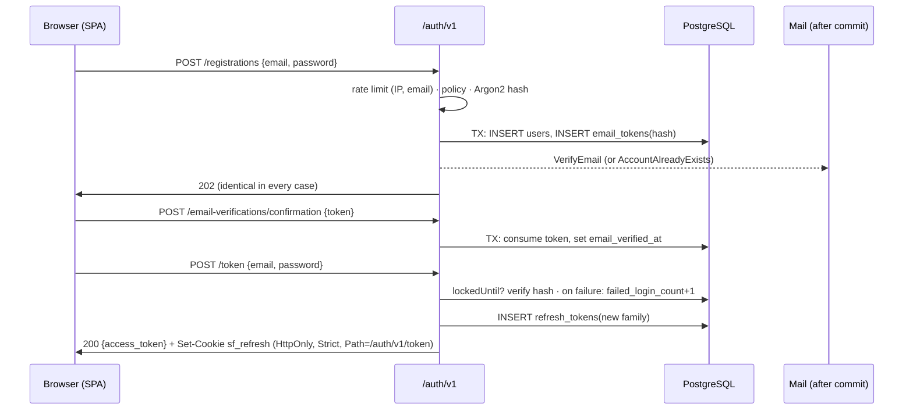
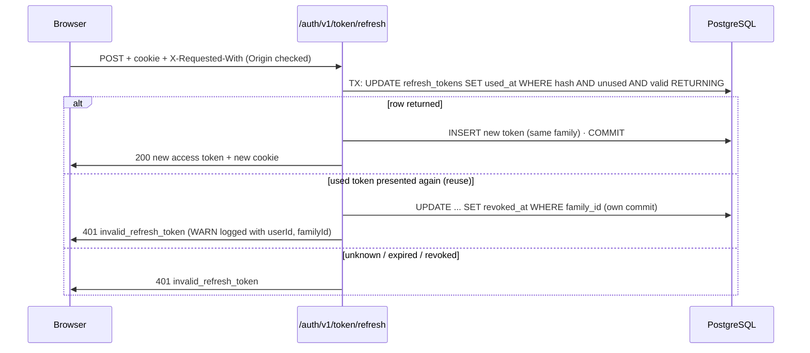

# Module: identity (P2)

**Responsibility:** platform user accounts (merchants and staff), credentials, sessions and tokens. Customers are *not* users. They are store-scoped (P7).

**Public API** (`dev.storeforge.identity`): `UserPrincipal(userId)`, the authenticated caller, available in any controller via `@AuthenticationPrincipal`.
**Depends on:** `shared`, `notifications` (`EmailSender`).

## Data

| Table | Purpose | Key constraints |
|---|---|---|
| `users` | Account, password hash, verification, security stamp, lockout counters | `uq_users_email` on `citext`; `ck_users_status`; email ≤ 254 |
| `refresh_tokens` | Hashed refresh tokens grouped in families | `uq_refresh_tokens_token_hash`; FK → users (cascade) |
| `email_tokens` | Hashed single-use tokens for verification/reset | `uq_email_tokens_token_hash`; `ck_email_tokens_purpose` |

## Invariants and where they are enforced

| Invariant | Enforced by |
|---|---|
| One account per email, case-insensitively | `EmailAddress` normalization + `UNIQUE` on `citext` (races resolved by the constraint, see `RegistrationService`) |
| A refresh token rotates at most once | Conditional `UPDATE ... WHERE used_at IS NULL RETURNING` (`RefreshTokenStore.consume`) |
| Reuse of a rotated token kills the family | `TokenService.refresh` (revocation committed outside the failing request's transaction) |
| Email tokens are single-use, expiring, newest-only | `EmailTokenStore.consume` / `replace` |
| Every failed login is counted | Atomic `failed_login_count + 1` (`UserLoginCounters`), not entity read-modify-write |
| A password reset ends every session | Same transaction: password + `security_stamp++` + revoke all refresh tokens |
| Unverified users cannot get tokens | `LoginService` (after the password check) |

## Flows

Authenticating an API request (`/admin/**`): `BearerTokenAuthenticationFilter` → `NimbusJwtDecoder` (ES256 only, our JWKS, RFC 9068 validators) → `UserTokenConverter` (user ACTIVE, `sstamp` matches) → `UserPrincipal` → `UserMdcFilter` puts `userId` into the logs.

## Security notes
Account enumeration resistance (registration, reset, resend, login), hashing parity (dummy hash for unknown emails), per-IP + per-email rate limits, temporary exponential lockout, secrets hashed at rest, redacted `toString()` on every DTO/event carrying secrets, tokens never in URL paths or logs (tested).

## Tests
`RegistrationIT`, `LoginIT`, `TokenRefreshIT`, `AccessTokenSecurityIT`, `PasswordResetIT`, `SensitiveDataLoggingIT`, `EmailAddressTest`.

## Known limitations
- Emails are sent synchronously after commit, without durability (P9 → outbox).
- Rate-limit buckets are per instance (P12 → Redis).
- No MFA (P14), no breached-password check (P14).
- An SMTP server that accepts connections but hangs blocks registration for up to the SMTP timeouts (2s connect, 5s read/write). P9 removes email sending from the request path.
