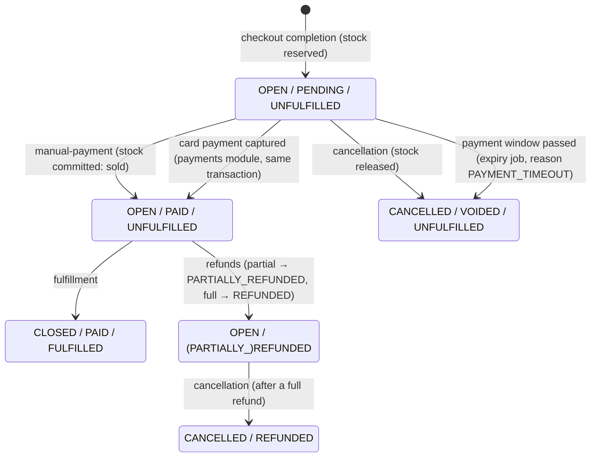

# Module: orders (P8)

**Responsibility:** the record of a sale after checkout completion: payment state, fulfillment, cancellation, expiry, history.

**Public API** (`dev.storeforge.orders`): `Orders.place(storeId, OrderPlacement)` (`MANDATORY` transaction, called by checkout completion) and `Orders.reservationHold()` (how long checkout must reserve stock).
**Depends on:** `shared`, `stores` (`StoreAccess`), `inventory` (commit/release), `audit`, `identity`. **Used by:** checkout.

## State machine ([ADR-014](../decisions/ADR-014-orders-lifecycle.md))

## Data (V7)

| Table | Notes |
|---|---|
| `orders` | `UNIQUE (store_id, number)`, `UNIQUE (store_id, checkout_id)` (one order per checkout); CHECKs for totals and forbidden state combinations; partial index on `payment_due_at` for unpaid open orders |
| `order_items` | Immutable snapshot (UPDATE/DELETE revoked); `line_total = unit × qty` CHECK |
| `order_events` | Append-only timeline: PLACED, PAID, FULFILLED, CANCELLED, EXPIRED; P10: REFUNDED (incl. compensations), PAYMENT_FAILED |
| `orders.refunded_minor` (V9) | Sum of merchant refunds; CHECK `≤ total_minor` |
| `store_counters` | Next order number per store (gapless, transactional) |
| `checkouts.order_id` | Link from checkout to its order |

## Flows
- **Placement:** inside the completion transaction: `nextOrderNumber` (counter row UPDATE, locked until commit) → `orders` row → `order_items` → `PLACED` event. A failure anywhere (e.g. insufficient stock) rolls everything back, including the number.
- **Transition:** tenant transaction → `orders:write` → `SELECT … FOR UPDATE` → state-machine method → inventory commit/release → timeline event + audit → commit.
- **Expiry:** `UnpaidOrderExpiry` (every 30s) → `stores_with_overdue_orders(cutoff)` → per store: `SKIP LOCKED` claim → `expireIfOverdue` → release stock → `EXPIRED` event.

## Shipments (P13)
- `ShipmentService.ship(lines | everything remaining, carrier, tracking)` under the **order row lock**: remaining = ordered − shipped in non-cancelled shipments; `422 quantity_exceeds_remaining` / `nothing_to_ship`; the order must be paid and open.
- Fulfillment status: `UNFULFILLED → PARTIALLY_FULFILLED → FULFILLED` (the order closes). Timeline: `SHIPPED` per shipment, then `FULFILLED`.
- Delivery: SHIPPED → DELIVERED. Cancelling an in-transit shipment returns its quantities and reopens the order (`SHIPMENT_CANCELLED`). Orders with shipments can't be cancelled (`order_has_shipments`).
- Event `OrderShipped` → webhook `fulfillments/create` (`shipmentId, carrier, trackingNumber, complete`). P8's `/fulfillment` ships everything remaining.
- Data (V14): `shipments`, `shipment_items` (RLS). Tests: `ShipmentIT` (partial, over-shipping, unpaid, concurrent shipments mutation-checked, cancel/deliver), `WebhookDeliveryIT.eachShipmentIsAFulfillmentWebhook`.
- Orders also store `discount_minor`, `discount_code`, `shipping_minor`, `shipping_rate_name` ([ADR-023](../decisions/ADR-023-discounts-shipping-and-order-totals.md)).

## Tests
`OrderStateMachineTest` (every legal and illegal transition, pure unit), `OrderPlacementIT` (snapshot, per-store numbering, **12 concurrent orders → #1001..#1012**, immutable lines), `OrderLifecycleIT` (pay → sell → fulfil, cancel releases, illegal transitions, **pay vs. cancel race ×5**, expiry, list filters/search, read-only role); orders endpoints in `TenantIsolationIT`.

## Known limitations
- Payments and refunds: see [payments.md](payments.md). Refunds don't restock automatically (the merchant adjusts inventory).
- Returns and exchanges aren't modelled; a delivered shipment can't be cancelled.
- No events to other systems yet (P9 outbox → emails, webhooks).
- Customers can't look up their order yet (no order status page or customer accounts).
