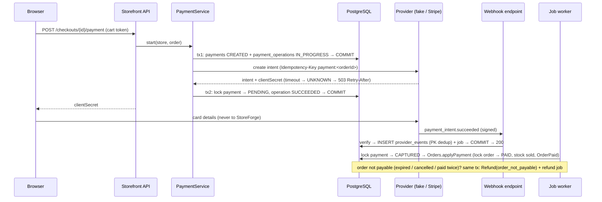

# Module: payments (P10)

**Responsibility:** collecting an order's money through a payment provider, refunds, provider webhooks, reconciliation. Card data never reaches StoreForge: the browser sends it to the provider with the payment's `clientSecret` (PCI DSS SAQ-A scope).

**Public API** (`dev.storeforge.payments`): `Payments.start(storeId, orderId)` and `Payments.find(...)`, used by the storefront checkout.
**Depends on:** `orders` (`Orders.paymentTarget/applyPayment/applyRefund/recordPaymentFailure`, `OrderEvents`), `jobs`, `stores` (`StoreAccess`), `audit`, `identity`, `shared`. **Used by:** checkout.
**Decision:** [ADR-017](../decisions/ADR-017-payments.md). **API:** [api/payments.md](../api/payments.md).

## State machines

```mermaid
stateDiagram-v2
    [*] --> CREATED: start (amount from the order)
    CREATED --> PENDING: provider intent created (clientSecret)
    CREATED --> FAILED: provider rejected creation
    PENDING --> PENDING: declined card (failureCode; shopper may retry)
    PENDING --> CAPTURED: succeeded (webhook / reconciliation / cancel race)
    PENDING --> CANCELLED: order cancelled or expired
    CANCELLED --> CAPTURED: provider says it succeeded anyway → compensation refund
    CAPTURED --> PARTIALLY_REFUNDED
    CAPTURED --> REFUNDED
    PARTIALLY_REFUNDED --> REFUNDED
```

Order `financial_status` gained `PARTIALLY_REFUNDED` and `REFUNDED`. A paid order can be cancelled once it is fully refunded. Refunds: `PENDING → SUCCEEDED | FAILED`.

## Flows

- **Refund (merchant):**
  1. tx: `orders:refund` permission, `Idempotency-Key`, **lock the payment row**, check `amount ≤ captured − refunded − pending`, insert a `Refund PENDING` and enqueue a refund job due in 30 s, then commit.
  2. Synchronous provider call with key `refund:<refundId>`.
  3. tx: lock payment, then refund → `SUCCEEDED` → `Orders.applyRefund` → `OrderRefunded`.

  On timeout the refund stays `PENDING` and the job retries with the same key. A provider-pending refund is settled by webhook or by the job (retrieve).
- **Order cancelled or expired:** the `payment-cancellations` consumer of `OrderCancelled` cancels the provider intent. If the provider answers "already succeeded", the capture is applied and compensated.
- **Reconciliation** (`PaymentReconciliation`, every 5 min):
  - finds stores through the `stores_with_stale_payments` definer function;
  - for each stale payment: retries the creation with the same key (no provider id yet), or retrieves the intent and applies its status;
  - retries stale refunds;
  - isolates each item (one failure doesn't stop the run);
  - deletes `provider_events` older than 30 days.

## Data (V9)

| Table | Kind | Notes |
|---|---|---|
| `payments` | Tenant (RLS) | One per order (`UNIQUE (store_id, order_id)`); `UNIQUE (provider, provider_payment_id)`; CHECK `refunded ≤ captured ≤ amount`; partial index for stale CREATED/PENDING |
| `payment_operations` | Tenant (RLS) | Every provider call: kind CREATE/REFUND/CANCEL, idempotency key, IN_PROGRESS/SUCCEEDED/FAILED/UNKNOWN, attempts |
| `refunds` | Tenant (RLS) | `UNIQUE (store_id, idempotency_key)` = the merchant request's idempotency record; `merchant:<key>` / `compensation:<paymentId>` |
| `provider_events` | Infrastructure (no RLS, like `jobs`) | PK `(provider, event_id)` = webhook dedup; raw payload kept 30 days |
| `orders.refunded_minor` | Tenant | CHECK `≤ total`; new financial statuses; cancellation allowed when REFUNDED |

## Configuration
`storeforge.payments.*`:
- `provider` (`fake` | `stripe`), `webhook-tolerance` 5m, `refund-retry-delay` 30s;
- `reconciliation.{interval 5m, stale-after 10m, provider-event-retention 30d}`;
- `circuit-breaker.{failure-rate-threshold 50, sliding-window 20, minimum-calls 10, open-for 30s}`;
- `fake.{webhook-secret, webhook-url}`;
- `stripe.{base-url, secret-key, webhook-secret, api-version, connect-timeout 2s, read-timeout 10s}`.

## Tests

| Test | What it proves |
|---|---|
| `StripeFormatTest` (unit) | Valid signature; modified body; wrong secret; missing or malformed header; replay window both directions; rotated secrets; event parsing |
| `PaymentTest` (unit) | State machine: idempotent capture, capture after cancel, declines, refund arithmetic |
| `StripePaymentProviderContractTest` (WireMock) | Request shape (auth, Idempotency-Key, Stripe-Version, form fields); 402/400 → rejected; 500/409 → unknown; 429 → not performed; **read timeout → unknown (bounded)**; **refused connection → not performed**; webhook verification |
| `CardPaymentIT` | Happy path, including stock sold; **8 concurrent starts → 1 payment, 1 intent**; **lost response → 503, retry → same intent**; decline then success; **6 concurrent + late + re-sent duplicate webhooks → applied once, no refund**; tampered, replayed, forged and unsigned webhooks → 400; only the shopper's completed checkout can be paid |
| `PaymentRecoveryIT` | **Lost webhook → reconciliation**; **one unknown payment doesn't stop reconciliation**; **pay-then-expire race → automatic refund**; merchant cancel → provider intent cancelled; **paid twice → card refunded**; **circuit breaker opens, fails fast without calling the provider, recovers** |
| `RefundIT` | Partial then full refund, then cancellation; idempotent retry; **10 concurrent refunds → exactly 4 succeed, never over the captured amount**; lost refund response → job completes it once; provider-pending refund settled by webhook; permission and state errors |

Mutation-checked in [EXP-010](../experiments/EXP-010-payment-mutations.md).

## Known limitations
- No 3-D Secure / `requires_action` handling in the fake; no disputes or chargebacks; no manual capture (authorize now, capture at fulfillment).
- One payment per order (no split payments, no gift cards).
- The fake provider's state is in memory: restarting the app forgets intents (its stale payments are then reported by reconciliation as failures).
- No rate limit on payment start yet (card-testing defense: P14).
- A Stripe test-mode run needs real test keys and the Stripe CLI to forward webhooks. It's documented but not automated.
