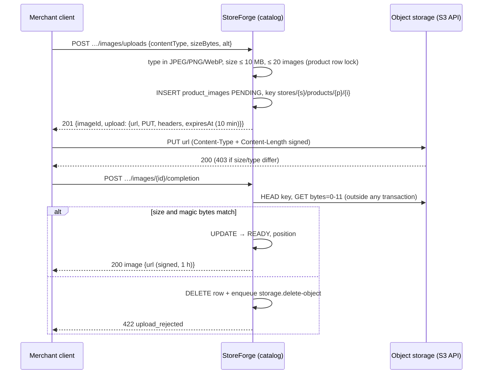

# Module: storage (P13)

**Responsibility:** object storage behind presigned URLs: sign uploads and downloads, inspect stored objects, delete them (now or reliably after commit).

**Public API:** `ObjectStorage` (`presignUpload`, `presignDownload`, `head`, `readPrefix`, `delete`, `deleteLater`).
**Depends on:** `jobs` (deletion job), `shared`.
**Used by:** catalog (product images).
**Decision:** [ADR-024](../decisions/ADR-024-object-storage-and-presigned-uploads.md). **Learning:** [presigned uploads](../learning/presigned-uploads-and-object-storage.md).

## Product image upload (catalog + storage)

## Configuration (`storeforge.storage.*`)
`endpoint` (app → S3), `public-endpoint` (in presigned URLs, for clients), `region`, `bucket`, `access-key`, `secret-key`, `path-style`, `create-bucket` (local/test only). Locally: SeaweedFS from `compose.yaml` on `localhost:8333`.

## Data (V17, catalog)
`product_images`: PENDING/READY, `object_key` (CHECK: exactly the tenant-prefixed shape), type, size, alt, position; RLS. `stores_with_abandoned_image_uploads` definer function for the sweeper.

## Observability
`storeforge_storage_requests_seconds{operation=head|read|delete, outcome}`, `storeforge_catalog_image_uploads_abandoned_total`, DEAD `storage.delete-object` jobs ([runbook](../operations/runbooks/object-storage-and-search.md)).

## Tests
`ImageSignaturesTest`, `ProductImagesIT` (7, real SeaweedFS), image endpoints in `TenantIsolationIT`; mutations in [EXP-019](../experiments/EXP-019-image-upload-safeguards.md).

## Known limitations
No thumbnails or re-encoding, no reordering endpoint, no developer-API access to images, no CDN (signed URLs expire after 1 h).
