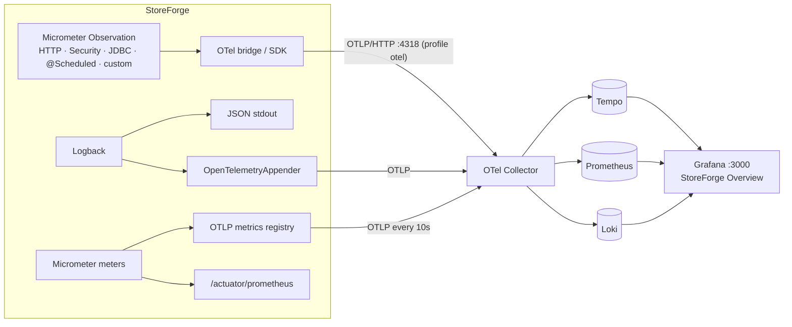

# Observability (as built)

Design and target stack: [blueprint/15-observability-monitoring.md](../blueprint/15-observability-monitoring.md). Decision: [ADR-012](../decisions/ADR-012-observability-pipeline.md). Introduced progressively: P1 logs/health/metrics endpoint, **P6 traces + OTLP pipeline + Grafana**.

## Pipeline

**Run it:** `docker compose --profile observability up -d`, then start the app with `SPRING_PROFILES_ACTIVE=otel ./mvnw spring-boot:run`, then open http://localhost:3000 (admin/admin) → Dashboards → StoreForge → *StoreForge Overview*. Use Explore → Tempo/Loki for ad-hoc queries.

## What we observe, why, and where the signal comes from

| Signal | Why | Source | Where to look |
|---|---|---|---|
| **Traces** | Where the time went in one request or job, across layers | Spring MVC/Security observations, `datasource-micrometer` (JDBC `connection`/`query` spans), `@Scheduled` tasks, custom `inventory.reserve` | Tempo; `X-Trace-Id` on every response, `traceId` in problem bodies |
| `storeforge.store_id` span attribute | "Show me store X's slow requests" without metric-cardinality explosion | `TenantTransactions` tags the current span | TraceQL `{ span.storeforge.store_id = "<id>" }` |
| **Structured logs** (ECS JSON) | Individual events and errors | Logback; stdout + OTLP | stdout / Loki `{service_name="storeforge"}` |
| `requestId`, `traceId`, `spanId`, `storeId`, `userId` log fields | Join logs to requests, traces, tenants, users | MDC (RequestIdFilter, Micrometer tracing, TenantTransactions, UserMdcFilter) | Every log line in scope; Loki structured metadata (`trace_id`, `requestId`, …) |
| `service.name/version/environment` | Which build, which environment | build-info, `ENVIRONMENT`, `management.opentelemetry.resource-attributes` | Logs; resource attributes on all OTLP data |
| **Liveness / readiness** | Restart vs. stop routing | Actuator health groups | `:8081/actuator/health/{liveness,readiness}` |
| `http_server_requests_*` (histogram) | RED per route and status | Spring MVC observation | Prometheus `http_server_requests_milliseconds_*` (via OTLP); `_seconds_*` on `/actuator/prometheus` |
| `hikaricp_connections_{active,idle,pending,max}`, acquire histogram | Pool saturation is the earliest DB trouble signal | Hikari | Dashboard "Database" row |
| `storeforge_inventory_reserve_*` (timer) | Reservation latency and outcome | `inventory.reserve` Observation | Prometheus |
| `storeforge_auth_logins_total{outcome}`, `…_token_refreshes_total{outcome}`, `…_registrations_total` | Auth health and attacks | identity | Dashboard "Business" row |
| `storeforge_ratelimit_rejected_total{limiter}` | 429s per limiter | `RateLimiter` | Dashboard |
| `storeforge_inventory_reservations_total{outcome}`, `…_expired_total` | Demand vs. stock-outs; abandoned checkouts | inventory | Dashboard |
| `storeforge_notifications_emails_total{outcome}` | Email delivery | notifications | Prometheus |
| `checkout.complete` span + `storeforge_checkout_complete_*` timer | Completion latency; the span parents the reservation and SQL spans | `CheckoutService` Observation | Tempo / Prometheus |
| `storeforge_checkouts_completions_total{outcome}` | `completed` / `total_changed` (price changed during checkout) | `CheckoutService` | Prometheus |
| `storeforge_idempotency_replays_total{scope}` | Retries answered from storage; a spike means clients are timing out | `Idempotency` | Prometheus |
| `jvm_*`, `process_*` | Memory, GC, threads, CPU | Micrometer binders | Bundled "JVM Overview" dashboard |

Log levels ([blueprint conventions](../blueprint/15-observability-monitoring.md#logs)): ERROR = unexpected, needs a human; WARN = handled degradation; INFO = business-significant state changes; DEBUG off by default.

## Cardinality rules
- **Metric tags:** low-cardinality only (status, route template, outcome, limiter). Never ids, emails or raw paths.
- **Span attributes / log fields:** ids are fine (store, user, checkout, request).
- In an Observation: `lowCardinalityKeyValue` becomes metric tag + span attribute; `highCardinalityKeyValue` becomes a span attribute only (see `DefaultInventory.reserve`).
- More in [learning/metrics-types-and-cardinality.md](../learning/metrics-types-and-cardinality.md).

## How to investigate a failure
1. Start from the symptom: dashboard (error ratio, p95 by route, pool pending), or a client's `X-Request-Id` / `X-Trace-Id` / problem `traceId`.
2. **Trace** (Tempo: by trace id, or TraceQL by route/store/duration): find the longest span. Typical culprits: `connection` (pool wait → saturation), `query` (slow SQL, lock wait), external calls (later phases).
3. **Logs** for that trace: Loki `{service_name="storeforge"} | trace_id="<id>"`, or the warn/error panel. Without the stack: `docker compose logs app --no-log-prefix | jq 'select(.traceId=="<id>")'`.
4. **Scope it:** same route for all stores (code/DB), or one store (TraceQL by `storeforge.store_id`: data shape or abuse)?
5. Database outage: readiness `db` DOWN, `hikaricp_connections_pending`; see the [runbook](../operations/runbooks/database-unavailable.md).

## Security signals worth watching
- `reuse_detected` > 0: a refresh token was replayed. See the [auth anomalies runbook](../operations/runbooks/auth-anomalies.md).
- `invalid_credentials` and `locked` rising together with `auth-ip` rejections: credential stuffing.

## Sensitive data
500 responses never contain exception details; the server log does. Credentials, tokens and email links never appear in output (`SensitiveDataLoggingIT`). JDBC spans contain SQL text but **never parameter values** (`jdbc.datasource-proxy.include-parameter-values=false`).

## Not yet
Alert rules and SLO burn-rate panels (P15/P16), tail sampling (P16), metric→trace exemplars (to verify with native histograms), trace propagation through async jobs (P9).
