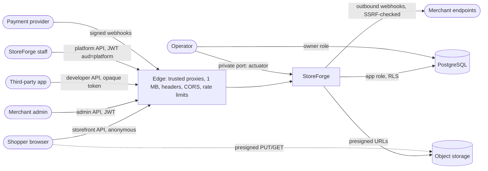

# Threat model (P14 review)

Method: STRIDE per trust boundary. For each boundary: what crosses it, what could go wrong, the control, and where it is tested. Design background: [blueprint 18](../blueprint/18-security.md).

| Boundary | Threat (STRIDE) | Control | Tested by |
|---|---|---|---|
| Shopper → storefront | **S**poofing the client address to dodge limits | Forwarded headers only from `TRUSTED_PROXIES` | `HttpEdgeIT`, `StorefrontRateLimitIT` (EXP-020) |
| | **D**oS: carts, search, huge bodies | Per-address limits (Redis), 1 MB bodies, capped search/paging | same, `ProductSearchIT` |
| | **T**ampering: prices, totals, discounts in requests | Server-side pricing, `expectedTotal` as a guard, unknown fields rejected | `PropertyLevelAuthorizationIT` |
| | Abuse: card testing, code guessing | Completion and discount-attempt limits | `StorefrontRateLimitIT` |
| | **I**nfo disclosure: XSS through merchant HTML | Allow-list sanitizer on write | `RichTextTest`, `PropertyLevelAuthorizationIT` |
| Merchant → admin | **E**levation: staff to owner, other stores (BOLA) | Permissions in services, RLS, 404 across stores | `FunctionLevelAuthorizationIT`, `TenantIsolationIT`, `RowLevelSecurityIT` |
| | **S**poofing: stolen tokens | Short JWTs + security stamp, refresh rotation with reuse detection | identity ITs (P2) |
| | CSRF from other origins | Bearer headers; CORS allow-list; refresh cookie SameSite + Origin | `TokenRefreshIT`, `HttpEdgeIT` |
| App → developer API | **E**levation beyond scopes; cross-store | `@RequiresScope` (architecture test), store binding, consent re-check | `DeveloperApiIT`, `OAuthInstallIT` (EXP-016) |
| Staff → platform | **S**poofing with a password alone | Mandatory TOTP step-up, separate audience, per-request re-check | `PlatformAdminIT` (EXP-021) |
| | **R**epudiation | Platform audit log + store audit log (ADMIN), append-only | `PlatformAdminIT` |
| | **E**levation: creating admins | App role can't INSERT into `platform_admins` | `PlatformAdminIT` |
| Provider → webhooks | **S**poofing/replay | HMAC over raw body, timestamp tolerance, dedup | payments ITs (P10) |
| App → merchant URLs | SSRF | Resolved-address check in the DNS resolver, no redirects | `WebhookDeliveryIT` (P11) |
| Clients ↔ object storage | Uploading something else; reaching other tenants' files | Signed type+length, magic-byte check, server-chosen tenant keys | `ProductImagesIT` (EXP-019) |
| App ↔ database | Tenant leaks through missing filters | Forced RLS, definer functions tenant-bound | `RowLevelSecurityIT` |
| Build ↔ third parties | Vulnerable/compromised dependencies, leaked secrets | Trivy gate, gitleaks, SBOM, pinned actions/images, Dependabot | CI jobs `image`, `secrets` (EXP-022) |
| Deployment config | Public development secrets in production | `DevelopmentSecretsGuard` (startup fails) | `DevelopmentSecretsGuardTest`, EXP-022 |
| Customers' rights | Data kept after an erasure request | `PersonalData` per module, whole-schema search test | `CustomerPrivacyIT` |

## Accepted risks (revisit)
- TOTP is phishable in real time (WebAuthn later); first enrollment needs only a password session.
- Per-address limits don't stop distributed attacks; no bot detection or CAPTCHA.
- Logs, provider records and backups are outside erasure (redaction conventions; retention).
- Admin API permission checks run after Bean Validation: invalid requests from unauthorized members get 422, not 403 (no data or action reached).
- Sessions of the OAuth login pages are per instance (P12 open item).
